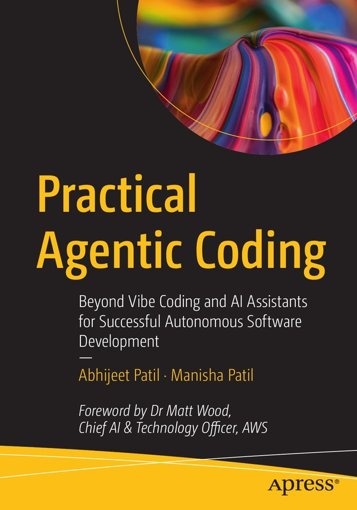

# Apress Source Code

This repository accompanies [*Practical Agentic Coding: Beyond Vibe Coding and AI Assistants for Successful Autonomous Software Development*](https://link.springer.com/book/9798868826696) by Abhijeet Patil and Manisha Patil (Apress, 2026).

[comment]: #cover


Download the files as a zip using the green button. Or clone the repository to your machine using Git.

## About this repository

Use this repository together with the book.

- The book explains the patterns, trade-offs, and design decisions, and when to use each one.
- This repository has the code, labs, templates, and worksheets to practice them.

Read the chapter first. Then come here to build.

The book writes repository paths with a `companion-repo/` prefix, as in `companion-repo/chapter-09/hands-on-lab/`. That prefix is this repository's root. Drop it, and use `chapter-09/hands-on-lab/`.

Chapter directories reference the book by top-level section number, for example "Section 9.6". Those numbers match the printed section headings.

## How to read this repository

### Start with the chapter README

Each chapter has its own directory, `chapter-01` through `chapter-16`. Each one opens with a `README.md` that says:

- what is there
- what you do
- which book section it maps to

Some chapters are not build chapters, so they ship no code.

| Part | Chapters | Topics |
|------|----------|--------|
| I: Foundations | 1-4 | Agentic coding history, memory and governance concepts, human-AI orchestration, recent advances |
| II: Tools and Platforms | 5-8 | Amazon Kiro, Google Antigravity and the Antigravity CLI, Cursor and GitHub Copilot, Claude Code |
| III: Workflows | 9-12 | Memory systems, multi-agent orchestration, DevOps and cloud, security and governance |
| IV: Implementation | 13-16 | Case studies, migration, KPIs and ROI, future directions |

| Chapters | What you will find here |
|----------|-------------------------|
| 1-2 | Nothing to run. These chapters are conceptual (history, core concepts). They have no code. |
| 3 | Copy-ready team-process templates: decision-authority matrix, hybrid standup format, sprint dashboard, hybrid retrospective. Still nothing to run. |
| 4 | Configuration examples (MCP, A2A agent cards, AGENTS.md, governance), four small Python pattern demos that run standalone, tutorials, and exercises. |
| 5-8 | One full hands-on project per tool chapter, plus tool configuration examples and setup tutorials. |
| 9-12 | A hands-on lab with `starter/` scaffolds and tests, a challenge lab, and code examples per section. |
| 13, 15 | Worksheets, rubrics, and KPI references. Discussion chapters with no code lab. |
| 14 | Assessment documents plus a hands-on lab and challenge lab that install and run the AWS AI-DLC workflow. |
| 16 | The future-roles-and-skills supplement and the key-advancements log (`UPDATES.md`). No code lab. |

### Lab layout

Where a chapter ships a lab, it follows this shape:

```text
chapter-NN/
├── README.md            # What is here, what you do, which book section it maps to
├── code-examples/       # Standalone code illustrating chapter sections
├── tutorials/           # Tool setup walkthroughs (Chapters 4-8)
├── hands-on-lab/        # The guided lab
│   ├── starter/         # Scaffolded code with TODOs for you to fill in
│   ├── complete/        # Reference solution (where the lab has one)
│   ├── exercises/       # Step-by-step guides, one per lab stage
│   └── tests/           # Tests that check your work (Chapter 12; in Chapters 9-11, starter/tests/)
└── challenge-lab/       # Open-ended extension
```

Layout varies a little between chapters:

- Chapters 11 and 12 nest `challenge-lab/` inside `hands-on-lab/`.
- Chapter 8 nests `tutorials/` inside `hands-on-lab/`.
- Chapters 5 through 8 keep the lab project itself (`daily-briefing-agent/`, `moneymind/`, `linkforge/`, `supportflow/`) rather than a `starter/` and `complete/` pair.

Each chapter README lists its own layout. Start there.

### Hands-on labs

Times and prerequisites here come from each lab's own README. That README is the authority. Each time covers the main lab only, unless the row says otherwise. Challenge labs have separate budgets, listed after the table.

| Chapter | Lab | What you build | Time | Main prerequisites |
|---------|-----|----------------|------|--------------------|
| 5 | Section 5.7 | Daily Briefing agent, built with Kiro spec-driven development | 2.5-3 hours | Amazon Kiro, Python 3.11+, uv, Docker Desktop, AWS account (Bedrock) |
| 6 | Section 6.6 | MoneyMind, an agentic finance dashboard with Genkit observability | ~2.5 hours | Antigravity IDE, Antigravity CLI (`agy`), Node.js 22+, Gemini API key |
| 7 | Section 7.6 | LinkForge, a URL shortener built across Cursor and GitHub Copilot | 2-4 hours | Cursor, Copilot in VS Code (a plan that includes the cloud agent, not Copilot Free), Python 3.11+, Docker |
| 8 | Section 8.6 | SupportFlow, support automation under a CLAUDE.md constitution | 2-4 hours | Claude Code, Python 3.11+, `jq`, Docker (Phase 5) |
| 9 | Section 9.6 | DevMemory, a cognitive memory system (Mem0 + ChromaDB) | ~90 min | Docker Desktop, Python 3.11 to 3.14, an OpenAI API key (Mem0's default model) |
| 10 | Section 10.7 | An agent team: security, documentation, and manager agents | 90-120 min, covering both 10.7 and the 10.8 challenge | Claude Code, `jq`, Bandit or ASH |
| 11 | Section 11.6 | Zero-downtime deployer with canary rollout and rollback | 2-4 hours including setup | Python 3.11+ and Git. Docker and API keys are optional; Kubernetes only for the optional real-cluster extension |
| 12 | Section 12.8 | Governance pipeline: validators, resource budget, audit log | 60-90 min | Python 3.11+ only |
| 14 | Section 14.9 | AI-DLC install plus a full Inception and Construction cycle | 60-90 min | Claude Code CLI (or another Part II tool), Python 3.11+, Git. Docker only if you want a real test database |

Chapter 10 also ships a **bonus** lab, separate from its main one. In `chapter-10/hands-on-lab/`, you write Python against the Anthropic SDK with Redis to build three of the chapter's coordination patterns:

- a manager agent
- direct peer messaging
- a blackboard

The bonus lab takes 3-4 hours and needs Docker and an Anthropic API key. The main Chapter 10 lab runs in Claude Code with the agent definitions in `chapter-10/code-examples/`.

Most chapters also have an open-ended challenge that extends the main lab. Budget its time on top of the times above:

- Chapter 5: the chapter exercises, in `chapter-05/challenge-lab/`
- Chapter 6 (Section 6.7) and Chapter 7 (7.7): at the end of the lab README
- Chapter 8 (8.7): three challenges in `chapter-08/hands-on-lab/exercises/`
- Chapters 9 (9.7), 10 (10.8, inside the 90-120 min above), 11 (11.7, 2-3 hours), 12 (12.9, 90-120 min), and 14 (14.10): in their own `challenge-lab/` directories

### Case study

One directory sits outside the chapter numbering: **[casestudy/revenuemgmtsystem/](casestudy/revenuemgmtsystem/)**. It holds ZenithStays, a hotel revenue-management design trail. It includes:

- specifications
- a multi-agent architecture
- UX documents
- AWS and GCP deployment plans
- a Node.js and Express backend that runs on mock data

No chapter discusses it. It is an extra worked example to read alongside Chapter 13, and [chapter-13/README.md](chapter-13/README.md) links to it. It is a reference application to read and run. It is not a guided lab. Its own README says what runs and how.

### Tool notes and update logs

Tools in this space change faster than a printed page. Eight chapters of the book point you here for the current, tested versions of prompts and configuration. Keep these conventions in mind:

- **Tools are described as of November 7, 2026.** The labs, tutorials, and configuration files reflect each tool's documentation and releases on that date.
- **A note dated "As of November 7, 2026"** marks a place where a tool works differently from the printed book. The note says what to do today. Where a lab README and the book text disagree, the lab README is the tested version. Follow it.
- **"Go further" sections** are in the Chapter 4, 5, 6, 7, 8, 11, and 12 READMEs. They list tool capabilities to explore after you read the chapter. Each item says when it was introduced and links to the vendor page for current plans and availability.
- **[chapter-16/UPDATES.md](chapter-16/UPDATES.md)** lists key industry advancements in the tools and practices the book covers. Chapter 16, Section 16.7 promises this log.
- **[chapter-16/future-roles-and-skills.md](chapter-16/future-roles-and-skills.md)** is the roles-and-skills supplement. Section 16.4 promises it.
- **[chapter-14/hands-on-lab/UPDATES-AIDLC-2.0.md](chapter-14/hands-on-lab/UPDATES-AIDLC-2.0.md)** explains how to run the Chapter 14 lab on AWS AI-DLC Workflows 2.0.

### Dependencies and security

The labs and code examples are for learning. Do not use them in production.

Each lab's dependencies are pinned or locked to the versions it was tested with for this release. New vulnerabilities (CVEs) are published against open source packages all the time. As a result, `npm audit`, `pip-audit`, or GitHub may flag some of them. Before you reuse any of this code in a real project, check its dependencies yourself and update them.

## Getting started

Clone the repository once:

```bash
git clone https://github.com/Apress/Practical-Agentic-Coding.git
```

Every lab has its own setup steps, and they differ:

- Some labs need Docker.
- Some need an API key.
- Some need neither.
- Test paths differ between chapters.

**Read the lab README in the chapter you are starting.** The table under "Hands-on labs" above lists each one.

The Chapter 12 lab has no external dependencies. Use it to check that your machine is ready. This exact sequence works on a clean clone:

```bash
cd Practical-Agentic-Coding/chapter-12/hands-on-lab
python3 -m venv venv && source venv/bin/activate
pip install -r requirements.txt
python verify_setup.py
pytest tests/test_governance.py -v
```

On Windows:

- Create the environment with `py -m venv venv`.
- Activate it with `venv\Scripts\activate`.

The lab READMEs write `python3` for commands run outside a virtual environment, because macOS and most Linux distributions ship no bare `python`. On Windows, use `py` for those commands instead. Inside an activated environment, `python` works everywhere.

All 24 tests fail with `NotImplementedError` at that point. This is expected. The failing tests are the exercise.

1. Open `starter/governance/`.
2. Implement the TODOs.
3. Rerun the tests until they pass.

The other Part III labs follow the same steps:

1. Create a virtual environment.
2. Install `requirements.txt`.
3. Run `verify_setup.py`.
4. Fill in the TODOs.
5. Run the tests.

Each lab adds its own steps. Note these differences:

- Their tests live at `starter/tests/`, not `tests/`.
- Chapters 9, 10, and 11 also need `cp .env.example .env`.
- Chapter 9 and Chapter 10's bonus SDK lab start a Docker service first (ChromaDB and Redis respectively). They also need a model key before `verify_setup.py` passes.
  - Chapter 9 reads `OPENAI_API_KEY` from your shell environment. It can also use a local Ollama model, as its README describes.
  - The Chapter 10 bonus lab reads `ANTHROPIC_API_KEY` from `.env`.
- Chapter 11 runs entirely against mock infrastructure, so Docker and API keys are optional there. You need a Kubernetes cluster only for the optional real-cluster extension its lab README describes.
- Chapters 5 through 8 build applications with the tool itself. You do not fill in Python stubs, so setup differs more. Follow the lab README in those chapters.

## Prerequisites

- **Python** for every Python lab (Chapters 5, 7 to 12, and 14). Use Python 3.11 to 3.14. As of November 7, 2026, Python 3.15 has no wheels for some lab dependencies (Chapter 9's ChromaDB, through onnxruntime). It also breaks Chapter 10's ASH install. The Chapter 9 README covers the extra limit on Intel Macs.
- **Node.js** 22 or later for the Chapter 6 lab. 24 LTS is the recommended line. As of November 7, 2026, the MCP filesystem and memory servers used in the tool chapters require Node.js 24 or later.
- `jq` for the Chapter 8 and Chapter 10 hooks
- `black` for the Chapter 10 format-on-edit hook
- uv for the Chapter 5 MCP servers
- Docker Desktop for labs that run ChromaDB, Neo4j, Redis, or a local Kubernetes cluster
- Git
- The tool the chapter covers, for Part II labs (Kiro, Antigravity, Cursor, GitHub Copilot, Claude Code)

Each chapter's README lists its own setup steps and the API keys it needs. Most labs run entirely on your machine. These four call a model service and incur model usage costs:

- Chapter 5 calls Amazon Bedrock.
- Chapter 6 calls the Gemini API.
- Chapter 9 calls OpenAI (Mem0's default LLM and embedder). You can point it at a local Ollama model instead.
- Chapter 10's SDK variant calls the Anthropic API.

Chapter 12's lab needs nothing but Python.

## Releases

Release v1.0 is the first release of this repository. It accompanies the published book. Its tool notes are current as of November 7, 2026. See [CHANGELOG.md](CHANGELOG.md).

## Reporting issues

Open an issue at [github.com/Apress/Practical-Agentic-Coding/issues](https://github.com/Apress/Practical-Agentic-Coding/issues) if a lab step fails, a link is broken, or a command does not work on your platform. Include the items in this table:

| Include | Example |
|---------|---------|
| Chapter and section | Chapter 9, Section 9.6 |
| File path | `chapter-09/hands-on-lab/README.md` |
| The step you were on | Setup step 2 |
| What you expected and what happened | The install should finish; pip stopped with an error |
| Operating system | Windows 11, macOS 15, Ubuntu 24.04 |
| Tool and version | `python3 --version`, `node --version`, or the tool's own version output |
| Error output | The full message, pasted as text |

Never paste secrets, API keys, or the contents of a real `.env` file into an issue.

For errors in the book's text, see [errata.md](errata.md).

## Contributing

Corrections and platform notes from readers are welcome. To contribute:

1. Fork the repository and create a branch for your change.
2. Commit with a clear message that describes the correction.
3. Open a pull request.

These contributions help most:

- a lab step that fails
- a broken link
- a command that fails on your platform
- a tool behavior that differs from the lab, with a link to the vendor documentation that shows it
- a Windows, macOS, or Linux variation a lab does not cover

Also note:

- The `TODO` comments in the `starter/` directories are the exercise. Please do not submit solutions for them.
- The code matches the listings printed in the book. A change that diverges from a listing needs a reason in the pull request.

See [Contributing.md](Contributing.md) for the full guidance. Maintainer conventions are in [MAINTENANCE.md](MAINTENANCE.md). They cover layout, naming, style, and the pre-push checklist.

## License

Freeware License, some rights reserved. See [LICENSE.txt](LICENSE.txt).
