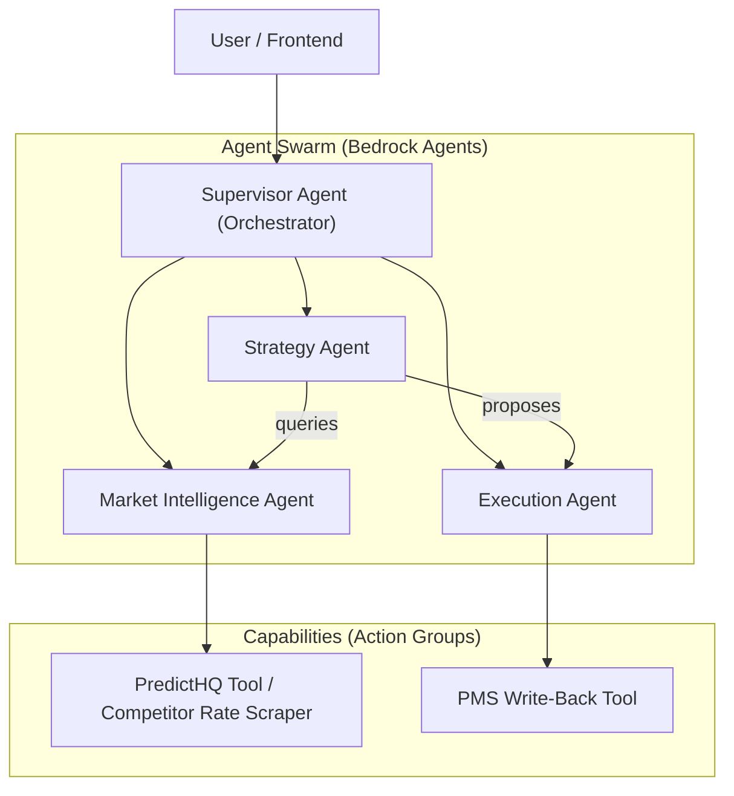

# Artificial Intelligence System Architecture
## Multi-Agent System on AWS Bedrock

This document details the Multi-Agent architecture using **AWS Bedrock Agents** and **AgentCore**.

> **Note (as of November 7, 2026):** This design dates from December 2025. It is kept as written, with four exceptions that match the current services: the Terraform resource names, the S3 Vectors storage block, model references, and Guardrails feature names. Amazon Bedrock Agents and Amazon Bedrock AgentCore are separate services. Bedrock Agents, which AWS calls Bedrock Agents Classic, is closed to new customers (from July 30, 2026). AWS recommends AgentCore for new agent work. See [Amazon Bedrock Agents Classic maintenance mode](https://docs.aws.amazon.com/bedrock/latest/userguide/agents-classic-maintenance-mode.html).

### 1. Conceptual Overview
We move beyond a single LLM call to a **Multi-Agent System** where specialized agents collaborate to solve complex Revenue Management problems.



### 2. Agent Definitions

#### 2.1 Supervisor Agent (Orchestrator)
*   **Role**: Triage user requests and delegate to specialized agents.
*   **Model**: A high-reasoning Claude model (Sonnet class or above). The design's original choice, Claude 3.5 Sonnet, is not among the current models on Amazon Bedrock.
*   **Instruction**: "You are the Revenue Director. Analyze the request. If it's about market data, ask the Market Agent. If it's about setting rates, consult the Strategy Agent first."

#### 2.2 Strategy Agent
*   **Role**: The "Brain". Formulates pricing strategies based on data.
*   **Inputs**: Occupancy, RevPAR, Competitor Rates, Event Impact.
*   **Action Group**: `evaluate_strategy`, `simulate_revenue`.
*   **Goal**: Maximize yield (RevPAR) without violating business rules.

#### 2.3 Market Intelligence Agent
*   **Role**: The "Eyes". Fetches external veracious data.
*   **Inputs**: Location, Date Range.
*   **Action Group**: `fetch_events (PredictHQ)`, `shop_rates (OTA)`.
*   **Goal**: Provide accurate demand signals.

#### 2.4 Execution Agent
*   **Role**: The "Hands". Applies changes to the PMS/Channel Manager.
*   **Inputs**: Rate Updates, MinLOS restrictions.
*   **Action Group**: `update_rate`, `update_inventory`, `sync_channels`.
*   **Safety**: Requires "Human-in-the-loop" approval for high-risk changes.

### 3. Implementation: AWS Bedrock Agents
We use **Amazon Bedrock Agents**, which manages the prompt engineering, memory, and tool invocation automatically. (Bedrock AgentCore is a separate service; see the note at the top.)

#### 3.1 Infrastructure as Code (Terraform Example)
```hcl
resource "aws_bedrockagent_agent" "strategy_agent" {
  agent_name = "ZenithStrategyAgent"
  agent_resource_role_arn = aws_iam_role.bedrock_role.arn
  foundation_model = var.agent_model_id # a current high-reasoning Claude model from the Bedrock model catalog
  instruction = "You are a senior revenue manager. Analyze demand spikes..."
}

resource "aws_bedrockagent_agent_action_group" "market_tools" {
  agent_id = aws_bedrockagent_agent.strategy_agent.id
  agent_version = "DRAFT"
  action_group_name = "MarketDataTools"
  api_schema {
    payload = file("openapi/market_tools.json")
  }
  action_group_executor {
    lambda = aws_lambda_function.market_tools_lambda.arn
  }
}
```

### 4. Integration Pattern
1.  **Frontend** sends prompt: *"Optimise rates for Christmas week in Miami"*.
2.  **Backend** calls `BedrockAgentRuntime.invokeAgent(SupervisorID)`.
3.  **Supervisor** understands "Optimize" -> calls **Strategy Agent**.
4.  **Strategy Agent** needs data -> calls **Market Agent**.
5.  **Market Agent** invokes Lambda -> fetches PredictHQ events -> returns "High demand: Art Basel".
6.  **Strategy Agent** formulates: "Raise rates by 20%".
7.  **Supervisor** returns response to user with "Approve?" button.

### 5. Benefits of this Approach
*   **Separation of Concerns**: We tune prompts for "Market Research" separately from "Strategic Reasoning".
*   **Tool Usage**: Bedrock handles the complex ReAct (Reason+Act) loop to call Lambdas.
*   **Memory**: Bedrock Agents maintain session state (conversation history) automatically.

### 6. Advanced Agent Capabilities

To ensure the agents behave safely and use internal business knowledge, we implement the following:

#### 6.1 Knowledge Base (RAG)
We connect the **Supervisor Agent** to a **Bedrock Knowledge Base** to give it access to unstructured company policy.

*   **Source Data**: S3 Bucket containing PDFs (e.g., "Revenue_Standard_Operating_Procedures.pdf", "Brand_Guidelines.pdf").
*   **Vector Store**: **Amazon S3 Vectors**.
*   **Use Case**: When a user asks "What is our policy on overbooking?", the agent queries the Knowledge Base.
*   **Benefit**: Significant cost reduction compared to OpenSearch Serverless for static datasets.

```hcl
# 1. The Knowledge Base (S3 Vectors)
resource "aws_bedrockagent_knowledge_base" "revenue_docs" {
  name     = "RevenueDocs"
  role_arn = aws_iam_role.bedrock_kb.arn
  knowledge_base_configuration {
    type = "VECTOR"
    vector_knowledge_base_configuration {
        embedding_model_arn = "arn:aws:bedrock:us-east-1::foundation-model/amazon.titan-embed-text-v1"
    }
  }
  storage_configuration {
    type = "S3_VECTORS"
    s3_vectors_configuration {
      # Index in an S3 vector bucket (aws_s3vectors_vector_bucket), defined elsewhere
      index_arn = aws_s3vectors_index.revenue_docs.index_arn
    }
  }
}

# 2. The Data Source (S3 Bucket)
resource "aws_bedrockagent_data_source" "s3_docs" {
  knowledge_base_id = aws_bedrockagent_knowledge_base.revenue_docs.id
  name              = "RevenueDocsS3Source"
  data_source_configuration {
    type = "S3"
    s3_configuration {
      bucket_arn = aws_s3_bucket.docs_bucket.arn
    }
  }
}
```

#### 6.2 Guardrails (Safety & Policy)
We apply **Bedrock Guardrails** to the Supervisor Agent to enforce strict boundaries.

*   **Denied Topics**: "Competitor Bashing", "Legal Advice", "HR/Personnel issues".
*   **Filter Strength**: High for Hate/Insults, Medium for Sexual/Violence.
*   **PII Redaction**: A Guardrails sensitive information filter masks emails and phone numbers in user inputs and model responses.
*   **Behavior**: If the user asks "How do I fire the Front Desk Manager?", the Guardrail intervenes: *"I cannot assist with HR matters. Please contact Human Resources."*

#### 6.3 Grounding (Truth Checking)
To prevent hallucinations (e.g., inventing a booking), we enable a Guardrails **contextual grounding check** on the agent's responses.

*   **Mechanism**: The agent's response is cross-referenced against the *Knowledge Base* or *Action Group Output*.
*   **Threshold**: 0.7 confidence.
*   **Action**: If the generated response is not supported by the retrieved data, the guardrail blocks it and returns a configured message: *"I found no data in the system to support that claim."*
