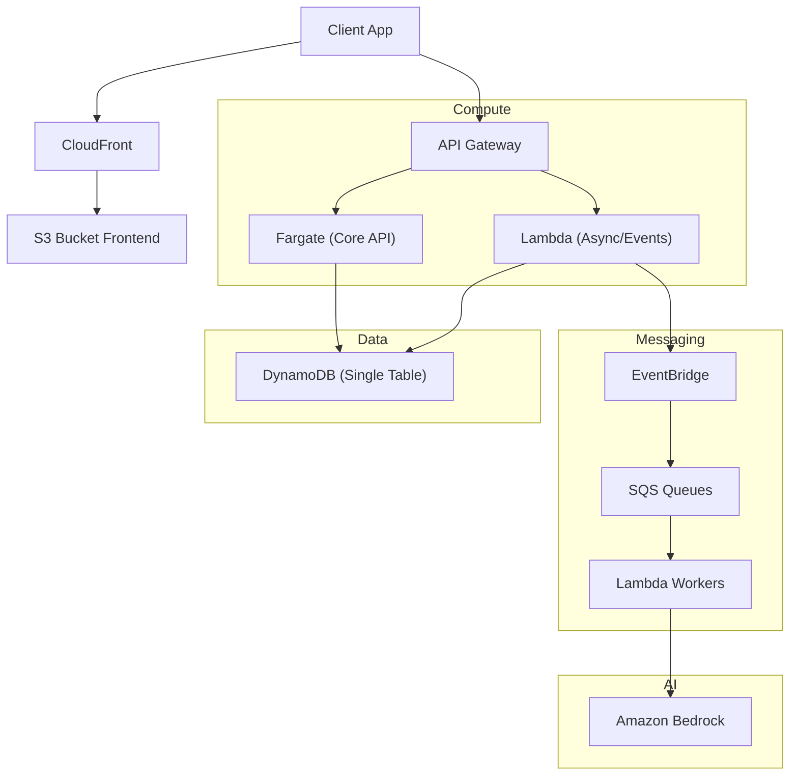
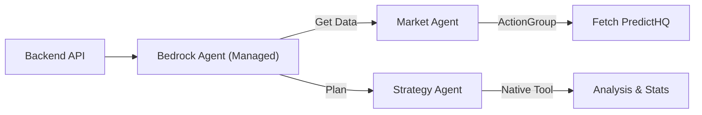
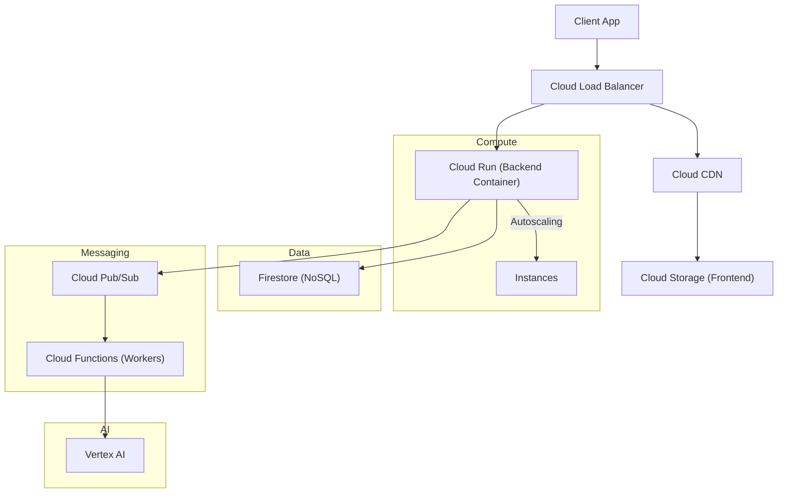
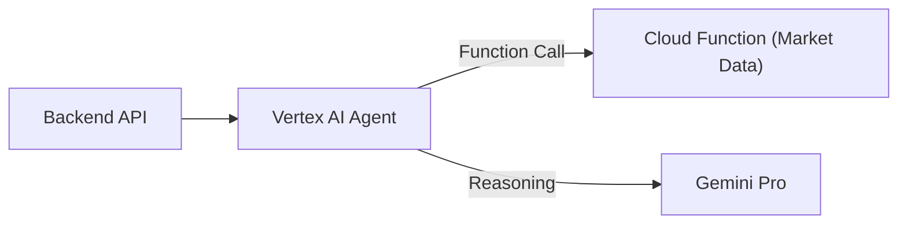

# Cloud Deployment Architecture: AWS & GCP

> **Note (as of November 7, 2026):** This comparison dates from December 2025 and is not maintained. Prices and service details differ today.
>
> - **DynamoDB pricing.** The AWS DynamoDB on-demand pricing page lists $0.625 per million write request units and $0.125 per million read request units in us-east-1. These are half the figures in Section 5. The arithmetic in the first and third takeaways there changes.
> - **Bedrock Agents.** Amazon Bedrock Agents, which AWS calls Bedrock Agents Classic, is closed to new customers (from July 30, 2026). AWS recommends Amazon Bedrock AgentCore for new agent work. This affects the choice in Section 1.3.
>
> Check the current AWS and Google Cloud pricing pages before you rely on any figure here.

This is the reference system architecture for deploying ZenithStays on Amazon Web Services (AWS) and Google Cloud Platform (GCP). It maps the logical components to specific cloud-native services to ensure scalability, security, and performance.

---

## 1. AWS Architecture (Amazon Web Services)

This architecture takes a **Serverless-First** approach with Container fallbacks for high-performance workloads.

### 1.1 Diagram

### 1.2 Component Breakdown
*   **Frontend**: Hosted on **S3** (Static Website Hosting) + **CloudFront** (CDN) for global low-latency delivery.
*   **API Gateway**: **Amazon API Gateway** (HTTP API) handles routing, throttling, and authorization (Cognito).
*   **Compute**:
    *   **Core API**: **AWS Fargate** (ECS) running Express.js containers for the Booking Engine (consistent performance).
    *   **Async/Background**: **AWS Lambda** for data syncing, report generation, and event processing.
*   **Database**: **Amazon DynamoDB** (On-Demand Capacity).
*   **Asynchronous Processing**: **Amazon EventBridge** (Event Bus) routing events to **SQS** (Simple Queue Service) for reliable processing.
*   **AI/ML**: **Amazon Bedrock** provides access to foundation models (Claude, Titan) via API.
*   **Video/Media**: **Amazon Kinesis Video Streams** (if needed for security feeds) or **Rekognition**.

### 1.3 Agentic AI Strategy (AWS)
We use **AWS Bedrock Agents** for the initial scalable implementation, with a path to **AgentCore** for advanced custom logic.

**Comparison:**
*   **AWS Bedrock Agents**: Fully managed, configuration-based. Perfect for our "Supervisor > Market > Strategy" flow using standard Action Groups (OpenAPI). **Selected for MVP**.
*   **Bedrock AgentCore** (GA as of Oct 2025): Modular infrastructure (Runtime, Memory, Identity) to build custom agents using code-first frameworks. Now production-ready for complex, non-standard orchestration.

*   **Orchestration**: Managed by Bedrock's native "Chain-of-Thought" engine.
*   **Detailed Analysis**: The Strategy Agent uses **Bedrock Code Interpreter** (native) to write and execute Python code for heavy statistical analysis (e.g., Regression, Forecasting) on the data.
*   **Action Groups**: OpenAPI schemas mapped to **Lambda** functions for external integrations.

---

## 2. GCP Architecture (Google Cloud Platform)

This architecture uses Google's strong container ecosystem and unified AI capabilities.

### 2.1 Diagram

### 2.2 Component Breakdown
*   **Frontend**: Hosted on **Cloud Storage** bucket + **Cloud CDN** behind a **Global Load Balancer**.
*   **Compute (Unified)**: **Cloud Run**. This is GCP's "hero" service. It runs stateless containers that scale to zero. It replaces *both* Fargate and Lambda for most use cases due to its rapid cold-start times and concurrency model.
*   **Database**: **Google Cloud Firestore** (Native NoSQL document store).
*   **Asynchronous Processing**: **Cloud Pub/Sub** for event messaging. **Cloud Functions** (2nd Gen) can consume these messages for background tasks.
*   **AI/ML**: **Vertex AI**. Unified platform for accessing Gemini and PaLM models.

### 2.3 Agentic AI Strategy (GCP)
We use **Vertex AI Agent Builder** (formerly Gen App Builder) to create similar autonomous agents.

*   **Vertex AI Agent Builder**: specialized for building defined flows and connecting to Data Stores.
*   **Function Calling**: Gemini models have native support for calling **Cloud Functions** defined in OpenAPI.

---

## 3. Service Mapping: AWS vs. GCP

| Logical Component | AWS Service | GCP Service | Notes |
| :--- | :--- | :--- | :--- |
| **Frontend Hosting** | S3 + CloudFront | Cloud Storage + CDN | Both offer similar static hosting. |
| **API Gateway** | API Gateway | Cloud Endpoints / API Gateway | GCP often uses Load Balancer direct to Cloud Run. |
| **Core Compute** | AWS Fargate (ECS) | Cloud Run | Cloud Run is generally easier to manage than ECS. |
| **Function/Serverless** | AWS Lambda | Cloud Functions | Cloud Run can also handle "Lambda" workloads. |
| **NoSQL Database** | DynamoDB | Firestore | Firestore has a more flexible query model; DynamoDB is faster at extreme scale. |
| **Event Bus/Queue** | EventBridge / SQS | Cloud Pub/Sub | Pub/Sub supports both queue and streaming patterns. |
| **AI Platform** | Amazon Bedrock | Vertex AI | Vertex provides deeply integrated tooling. |
| **Auth** | Cognito | Firebase Auth / Identity Platform | Firebase Auth is extremely developer-friendly. |

## 4. Multi-Cloud Considerations
If deploying to *both* simultaneously:
1.  **Dockerization**: Keep the application strictly containerized (Docker). Both Fargate and Cloud Run ingest Docker images.
2.  **ORM/DAL Adapter**:
    *   Abstract the database layer. Do not write `DynamoDB.putItem` directly in controllers.
    *   Create a `Repository` interface. Implement `DynamoDbRepository` and `FirestoreRepository`.
3.  **AI Abstraction**: Use an interface like Vercel AI SDK or LangChain to switch between Bedrock (Claude) and Vertex AI (Gemini) without rewriting code.

## 5. Pricing Comparison (Estimated - US East)

The following table compares the **On-Demand** costs for key services in the US East region (AWS `us-east-1` N. Virginia vs. GCP `us-east1` South Carolina).
*Last Verified: Dec 22, 2025*

| Category | Component | AWS (us-east-1) | GCP (us-east1) | Notes |
| :--- | :--- | :--- | :--- | :--- |
| **Compute** | **Container Hosting** | **Fargate (Linux x86)**: • vCPU: **$0.04048** / hr • Memory: **$0.004445** / GB-hr | **Cloud Run (Tier 1)**: • vCPU: **$0.0864** / hr ($0.000024/sec) • Memory: **$0.0090** / GB-hr • Requests: $0.40 / million | Cloud Run compute is ~2x Fargate On-Demand, but offers "scale to zero" and a generous free tier (180k vCPU-secs/mo). |
| **Database** | **NoSQL Operations** | **DynamoDB (Standard)**: • Writes: **$1.25** / million (1KB units) • Reads: **$0.25** / million (4KB units) • Storage: $0.25 / GB-month | **Firestore**: • Writes: **$1.80** / million (per doc) • Reads: **$0.60** / million (per doc) • Storage: **$0.18** / GB-month | DynamoDB is cheaper for high-throughput small ops. Firestore charges per *document*, making it cheaper for complex/large objects (>4KB). |
| **Object Storage** | **Standard Class** | **S3 Standard**: • Storage: **$0.023** / GB-month • PUT/COPY/POST: $0.005 / 1,000 • Egress: **$0.09** / GB (Tiered, first 100GB free) | **Cloud Storage (Standard)**: • Storage: **$0.020** / GB-month • Class A Ops: $0.005 / 1,000 • Egress: **$0.12** / GB (Standard Tier) | AWS S3 has slightly higher storage cost in this region, but lower internet egress rates ($0.09 vs $0.12). |
| **Serverless** | **Functions** | **Lambda (x86)**: • Requests: **$0.20** / million • Duration: ~$0.00001667 / GB-sec | **Cloud Functions (Gen 2)**: • Pricing matches **Cloud Run**. • Requests: $0.40 / million | Lambda request costs are 50% lower. Cloud Functions Gen 2 benefits from Cloud Run's concurrency model (simultaneous requests per instance). |
| **Networking** | **Load Balancer** | **ALB**: • **$0.0225** / hr • **$0.008** / LCU-hour | **Cloud Load Balancer**: • **$0.025** / hr (Forwarding Rule) • **$0.008** / GB processed | AWS bills on "Capacity Units" (LCUs). GCP bills on strict data processed volume + hourly rule charge. |

**Key Takeaways by Workload:**
1.  **High Frequency, Small Data**: **AWS DynamoDB** is significantly more cost-effective. Writing 1M small records costs $1.25 vs ~$1.80 on Firestore. Reading them costs $0.25 vs $0.60.
2.  **Sporadic / Startup Traffic**: **GCP Cloud Run** is superior due to its Free Tier (2M requests, 180k vCPU-seconds free/mo). Fargate has no perpetual free tier and a 1-minute minimum charge per task.
3.  **Large Documents**: If your average document size is large (e.g., 20KB user profiles), **GCP Firestore** wins. A 20KB read on DynamoDB consumes 5 RRUs ($0.00000125), whereas Firestore charges 1 Read ($0.0000006).
4.  **Egress-Heavy Apps**: **AWS** generally offers cheaper data transfer rates to the open internet ($0.09/GB vs $0.12/GB), which scales up significantly for media-heavy apps.
