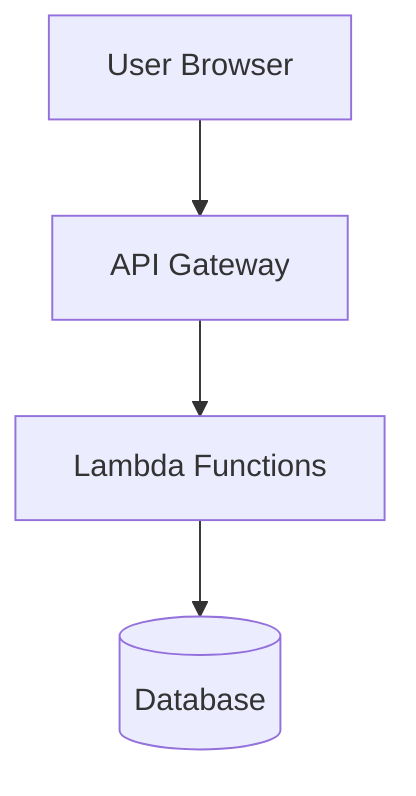

# Kiro Spec Templates

This directory holds templates for Kiro spec documents. Kiro uses them in Spec-Driven Development (SDD).

When to use specs and why: Chapter 5, Section 5.2.

## Overview

Kiro uses three spec documents:

| Document | Purpose | Phase |
|----------|---------|-------|
| `requirements.md` | Define what the system should do | Requirements |
| `design.md` | Define how the system will be built | Design |
| `tasks.md` | Define the implementation work breakdown | Implementation |

## Usage

### Creating a New Spec

1. In Kiro, click the ghost icon in the left panel.
2. In the SPECS section, click (+) to create a new spec.
3. Enter your prompt. Kiro generates initial requirements from it.
4. Click "Move to Design Phase", then "Move to Implementation Plan", to move through the phases.

### Using These Templates

Copy the templates into your project and edit them:

```bash
# run from chapter-05/code-examples/specs/; the project here is ~/daily-briefing-agent
mkdir -p ~/daily-briefing-agent/.kiro/specs/my-feature
cp requirements-template.md ~/daily-briefing-agent/.kiro/specs/my-feature/requirements.md
cp design-template.md ~/daily-briefing-agent/.kiro/specs/my-feature/design.md
cp tasks-template.md ~/daily-briefing-agent/.kiro/specs/my-feature/tasks.md
```

On Windows (PowerShell):

```powershell
New-Item -ItemType Directory -Force $HOME\daily-briefing-agent\.kiro\specs\my-feature
Copy-Item requirements-template.md $HOME\daily-briefing-agent\.kiro\specs\my-feature\requirements.md
Copy-Item design-template.md $HOME\daily-briefing-agent\.kiro\specs\my-feature\design.md
Copy-Item tasks-template.md $HOME\daily-briefing-agent\.kiro\specs\my-feature\tasks.md
```

## File Descriptions

| Template | Description |
|----------|-------------|
| `requirements-template.md` | Standard requirements format with EARS-style acceptance criteria |
| `design-template.md` | Architectural design document with components and data models |
| `tasks-template.md` | Implementation task breakdown with dependencies |

## Requirements Document Structure

### Key Sections

1. **Introduction**: Brief description of the feature/system
2. **Glossary**: Domain-specific terms and definitions
3. **Requirements**: Numbered requirements with user stories and acceptance criteria

### EARS Syntax for Acceptance Criteria

Use Easy Approach to Requirements Syntax (EARS) patterns:

| Pattern | Format | When to Use |
|---------|--------|-------------|
| When/Then | WHEN [trigger] THEN [system] SHALL [action] | Event-driven behavior |
| Where | WHERE [condition] THEN [system] SHALL [action] | Conditional behavior |
| If/Then | IF [condition] THEN [system] SHALL [action] | Error handling, alternatives |

## Design Document Structure

### Key Sections

1. **Overview**: High-level description of the design
2. **Architecture**: System architecture with diagrams
3. **Components and Interfaces**: Detailed component specifications
4. **Data Models**: Database schemas and data structures
5. **Error Handling**: Error scenarios and recovery strategies

### Mermaid Diagrams

Use Mermaid syntax for architectural diagrams:



## Tasks Document Structure

### Task Format

```markdown
- [ ] 1. Task title
  - Subtask 1 description
  - Subtask 2 description
  - _Requirements: 1.1, 2.3_
```

### Task Dependencies

Order tasks by their dependencies. Reference them like this:

```markdown
- [ ] 2.1 Create data models
  - _Depends on: 1.1_
  - _Requirements: 3.1, 3.2_

- [ ] 2.2 Create repository layer
  - _Depends on: 2.1_
  - _Requirements: 3.1_
```

## Example Workflow

1. **Create requirements** from your prompt.
2. **Review requirements** with stakeholders.
3. **Generate the design** with "Move to Design Phase".
4. **Add technical constraints** in chat.
5. **Review and refine the design.**
6. **Generate tasks** with "Move to Implementation Plan".
7. **Run the tasks** one at a time.
8. **Repeat** as needed.

## Related Documentation

- [SDD methodology tutorial](../../tutorials/sdd-methodology.md)
- [Lab starter specs, the thin versions you extend](../../hands-on-lab/daily-briefing-agent/.kiro/specs/tech-news-aggregator/)
- [Reference specs from the author's run, for comparison](../../daily-briefing-agent/.kiro/specs/tech-news-aggregator/)
- [Exercise 1: SDD basics](../../hands-on-lab/exercises/exercise-1-sdd-basics.md)
