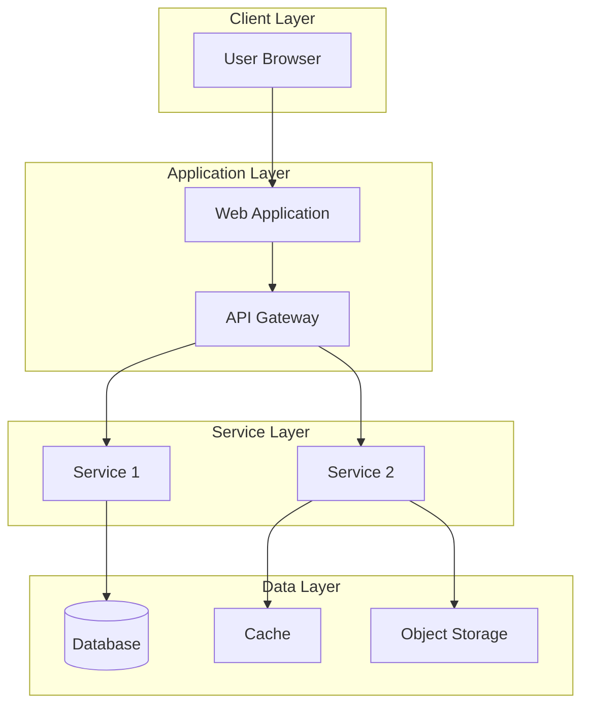
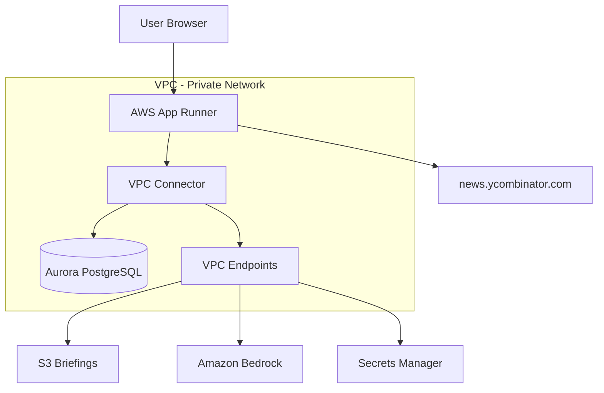

# Design Document Template

## Overview

[One paragraph summarizing the system design, key architectural decisions, and overall approach. This should give readers a quick understanding of how the system is structured.]

## Architecture

[Describe the high-level architecture, deployment model, and key infrastructure components.]

### Architectural Diagram



### Technology Stack

| Layer | Technology | Purpose |
|-------|------------|---------|
| Frontend | [Framework] | [Purpose] |
| Backend | [Language/Framework] | [Purpose] |
| Database | [Database Type] | [Purpose] |
| Cache | [Cache Solution] | [Purpose] |
| Infrastructure | [Cloud Provider] | [Purpose] |

## Components and Interfaces

### [Component 1 Name]

- **Purpose**: [What this component does]
- **Interfaces**: [What it connects to]
- **Responsibilities**: [What it is responsible for]
- **Key Methods**:
  - `methodName(params)`: [Description]
  - `anotherMethod(params)`: [Description]

### [Component 2 Name]

- **Purpose**: [What this component does]
- **Interfaces**: [What it connects to]
- **Responsibilities**: [What it is responsible for]
- **Key Methods**:
  - `methodName(params)`: [Description]

## Data Models

### [Model 1 Name]

```python
class ModelName:
    """
    [Description of what this model represents]
    """
    id: UUID                    # Unique identifier
    field_name: str             # [Description]
    another_field: datetime     # [Description]
    optional_field: Optional[int] = None  # [Description]

    # Relationships
    related_items: List[RelatedModel]  # [Description]
```

### Database Schema

```sql
CREATE TABLE table_name (
    id UUID PRIMARY KEY DEFAULT gen_random_uuid(),
    field_name VARCHAR(255) NOT NULL,
    another_field TIMESTAMP NOT NULL,
    optional_field INTEGER,
    created_at TIMESTAMP DEFAULT NOW(),
    updated_at TIMESTAMP DEFAULT NOW()
);

-- Indexes
CREATE INDEX idx_table_field ON table_name(field_name);
```

## API Endpoints

### [Endpoint Group]

| Method | Endpoint | Description | Auth Required |
|--------|----------|-------------|---------------|
| GET | `/api/resource` | List resources | Yes |
| GET | `/api/resource/{id}` | Get single resource | Yes |
| POST | `/api/resource` | Create resource | Yes |
| PUT | `/api/resource/{id}` | Update resource | Yes |
| DELETE | `/api/resource/{id}` | Delete resource | Yes |

### Request/Response Examples

**GET /api/resource**

Request:
```http
GET /api/resource?page=1&limit=20 HTTP/1.1
Authorization: Bearer <token>
```

Response:
```json
{
  "data": [
    {
      "id": "uuid-here",
      "field_name": "value",
      "created_at": "2025-01-01T00:00:00Z"
    }
  ],
  "pagination": {
    "page": 1,
    "limit": 20,
    "total": 100
  }
}
```

## Error Handling

### Error Response Format

```json
{
  "error": {
    "code": "ERROR_CODE",
    "message": "Human-readable error message",
    "details": {
      "field": "Additional context if applicable"
    }
  }
}
```

### Error Codes

| Code | HTTP Status | Description |
|------|-------------|-------------|
| VALIDATION_ERROR | 400 | Invalid request parameters |
| UNAUTHORIZED | 401 | Authentication required |
| FORBIDDEN | 403 | Insufficient permissions |
| NOT_FOUND | 404 | Resource not found |
| INTERNAL_ERROR | 500 | Server error |

## Security Considerations

### Authentication

[Describe authentication mechanism]

### Authorization

[Describe authorization rules and permissions]

### Data Protection

[Describe encryption, secrets management, and data handling]

## Performance Considerations

### Caching Strategy

[Describe what is cached and how]

### Scalability

[Describe how the system scales]

### Monitoring

[Describe metrics and alerting]

## Deployment Strategy

### Environments

| Environment | Purpose | Configuration |
|-------------|---------|---------------|
| Development | Local testing | [Config details] |
| Staging | Pre-production testing | [Config details] |
| Production | Live system | [Config details] |

### CI/CD Pipeline

[Describe deployment pipeline]

---

## Example: Tech News Aggregator Design

### Overview

The Tech News Aggregator is a containerized Flask web application deployed on AWS App Runner with VPC connectivity to Aurora PostgreSQL and Amazon Bedrock for AI-powered summary generation.

### Architecture Diagram



### Key Design Decisions

1. **Aurora PostgreSQL over DynamoDB**: Chosen for complex queries, relationships, and ACID compliance
2. **App Runner over Lambda**: Simplified Flask deployment with automatic scaling
3. **VPC Endpoints**: All AWS service access through private network for security
4. **A fast Claude model on Bedrock**: Balance of speed, cost, and quality for summary
   generation. The exact model ID is a configuration value, not a design decision,
   because the Bedrock catalog changes and availability varies by region
