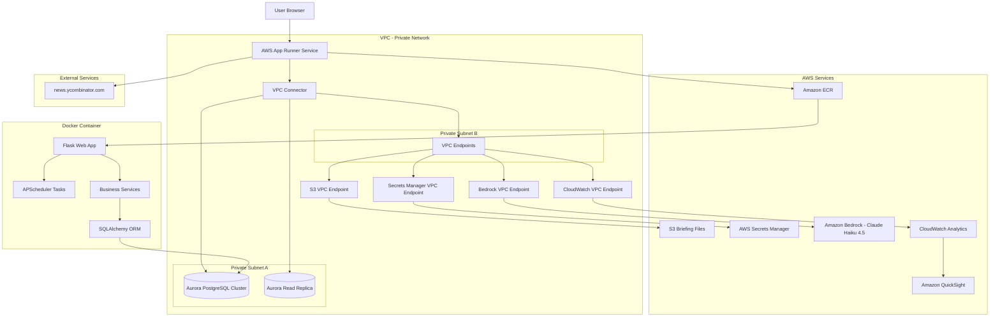
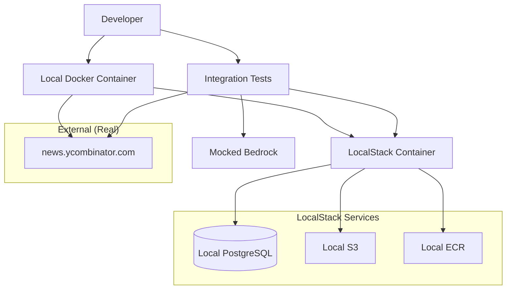

# Tech News Aggregator Design Document

> **Reference snapshot, not a live config.** This is the design document the author's
> Kiro session produced while writing Chapter 5. Read it to compare against your own
> output, not to copy from. In particular, the Bedrock model IDs and inference-profile
> ARNs below were current when the chapter was written and some have since been
> retired; the prose says Claude Haiku 4.5 while the literals still name an older
> Haiku snapshot. Confirm the current ID for your region in the Bedrock console under
> Model access before using any of them, and keep model IDs in configuration rather
> than in code. The account ID `123456789012` in the example ARNs is the AWS
> documentation placeholder. See `../../../README.md` for how to use this directory.

## Overview

The Tech News Aggregator is a web application that embodies a "Witty Tech Journalist" persona, delivering curated technology news with sharp, cynical commentary. The system automatically collects stories from multiple sources, generates witty summaries, and presents them through a clean, responsive interface that prioritizes substance over hype.

The application follows a modern web architecture with automated content processing, intelligent ranking algorithms, and a focus on performance and reliability.

## Architecture

The system employs a containerized architecture optimized for AWS App Runner deployment with VPC connectivity and enterprise-grade security:

**Container Platform**: Dockerized Flask web application deployed on AWS App Runner with automatic scaling and VPC Connector
**Database Layer**: Aurora PostgreSQL cluster in private subnet with connection pooling, read replicas, and automated backups
**VPC Networking**: Virtual Private Cloud with private subnets for database and VPC endpoints for AWS service connectivity
**Security Layer**: AWS Secrets Manager for credential management with automatic rotation and IAM roles with least privilege
**Container Registry**: Amazon ECR for storing and versioning Docker images with vulnerability scanning
**AI/ML Layer**: Amazon Bedrock with Claude Haiku 4.5 Global Inference profiles accessed through VPC endpoints
**Storage Layer**: S3 for daily briefing markdown files accessed through VPC endpoints
**Analytics Layer**: CloudWatch custom metrics and Amazon QuickSight for business intelligence dashboards
**Background Processing**: APScheduler within container for scheduled story collection and briefing generation
**Infrastructure**: CloudFormation templates for VPC, subnets, security groups, Aurora cluster, App Runner service, and VPC endpoints

The containerized architecture provides automatic scaling, simplified deployment, consistent runtime environments, and enhanced security through VPC isolation with private connectivity to all AWS services.

### Architectural Diagram



### Local Development Architecture with LocalStack



### Technology Stack

**Backend**: Python 3.11 with Flask framework in Docker container
**Database**: Aurora PostgreSQL cluster with SQLAlchemy ORM and Alembic migrations
**Container Platform**: AWS App Runner with VPC Connector for secure private network access
**Web Scraping**: requests and beautifulsoup4 libraries for Hacker News scraping
**AI/ML**: Amazon Bedrock with Claude Haiku 4.5 Global Inference profiles for summary generation
**Container Registry**: Amazon ECR for Docker image storage and versioning with vulnerability scanning
**Infrastructure**: AWS CloudFormation for Infrastructure as Code
**Networking**: VPC with private subnets for Aurora and VPC endpoints for AWS service connectivity
**Security**: AWS Secrets Manager for credential management with automatic rotation
**Analytics**: CloudWatch custom metrics and Amazon QuickSight for business intelligence
**Templates**: Jinja2 templates for HTML rendering
**Frontend**: Server-side rendered HTML with minimal JavaScript for interactions
**File Output**: Daily briefing files saved to S3 as 'briefing_YYYY-MM-DD.md' through VPC endpoint
**Local Development**: LocalStack for local AWS service emulation with Docker Compose
**Testing**: Hybrid approach using LocalStack for AWS services and moto for Bedrock mocking
**Background Tasks**: APScheduler for in-container task scheduling
**Database Migrations**: Alembic for version-controlled schema changes

## Deployment Strategy

### Hybrid Lightsail + Serverless Approach
The application uses a **hybrid architecture** combining the simplicity of Lightsail with serverless backend services:

**Primary Deployment**: AWS Lightsail + Lambda + DynamoDB + S3 + CloudFront
- Lightsail instance for Flask web application (~$3.50/month)
- Lambda functions for background processing (pay-per-use)
- DynamoDB for scalable data storage
- S3 for file storage and static assets
- CloudFront for global content delivery

**Local Development**: Direct Python execution with mock services
- `run_dev_server.py` for rapid development and testing
- Mock data and services for immediate feedback
- Hot reloading and debug capabilities

**Testing Strategy**: LocalStack for AWS service simulation
- Hybrid testing with LocalStack for DynamoDB, S3, SQS
- Mocked Bedrock for AI services (not available in LocalStack)
- Comprehensive integration testing without AWS costs

### Deployment Modes

**1. Development Mode**
- Direct Python execution with `run_dev_server.py`
- Mock data and services for rapid development
- Hot reloading and debug capabilities
- No AWS services required

**2. Local Integration Testing**
- LocalStack for realistic AWS service behavior
- Hybrid approach: LocalStack + mocked Bedrock
- Full workflow testing without AWS costs
- Data persistence for complex scenarios

**3. AWS Hybrid Production**
- Lightsail instance running Flask web application
- CloudFormation for serverless backend infrastructure
- Lambda functions for data collection and AI processing
- EventBridge for scheduling automated tasks
- DynamoDB for data storage
- Amazon Bedrock for AI processing

### Why Lightsail + Serverless Hybrid

**Cost Predictability**: Fixed Lightsail cost + pay-per-use serverless backend
**Simple Web Deployment**: One-click Flask deployment vs complex Lambda adapters
**Easy Debugging**: SSH access to Lightsail instance for troubleshooting
**Optimal Scaling**: Lightsail handles web traffic, Lambda scales for background jobs
**Best of Both Worlds**: Managed simplicity for UI + serverless scalability for processing
**Lower Complexity**: Avoid Flask-on-Lambda complications while keeping serverless benefits

## Components and Interfaces

### Amazon Bedrock Integration
- **Purpose**: Provides AI-powered summary generation using Claude Haiku 4.5 Global Inference profiles
- **Model Selection**: Claude 3.5 Haiku for optimal performance and cost efficiency, with fallback to Claude 3 Haiku for high-volume scenarios
- **Global Inference**: Utilizes Bedrock Global Inference profiles for improved latency and availability across regions
- **API Integration**: boto3 bedrock-runtime client for model invocation through VPC endpoints
- **Prompt Engineering**: Carefully crafted system prompts to maintain "Witty Tech Journalist" persona
- **Response Handling**: Streaming responses for long summaries, with timeout and retry logic
- **Cost Management**: Token usage tracking and optimization, with caching for repeated content
- **Security**: VPC endpoint connectivity, IAM role-based access, and Secrets Manager integration
- **Key Configuration**:
  - Primary Model: `anthropic.claude-3-5-haiku-20241022-v1:0` with Global Inference profile
  - Fallback Model: `anthropic.claude-3-haiku-20240307-v1:0` with Global Inference profile
  - Max tokens: 500 for summaries
  - Temperature: 0.7 for creative yet consistent output
  - Region: us-east-1 (Global Inference availability)

### Story Collector Service
- **Purpose**: Aggregates content from multiple tech news sources
- **Interfaces**: RSS feed parsers, API clients for major tech publications
- **Responsibilities**: Source monitoring, content extraction, deduplication
- **Key Methods**: `collectFromSources()`, `deduplicateStories()`, `validateContent()`

### Summary Generator Service  
- **Purpose**: Creates witty, cynical commentary for each story using Amazon Bedrock and Claude models
- **Interfaces**: Amazon Bedrock Runtime API, Claude model endpoints, content analysis tools
- **Responsibilities**: Persona-consistent summary generation using Claude 3.5 Sonnet, hype detection, prompt engineering
- **Key Methods**: `generateSummary(story)`, `detectHype(content)`, `maintainPersona()`, `callBedrockClaude()`

### Ranking Engine
- **Purpose**: Prioritizes stories based on importance, timeliness, and quality
- **Interfaces**: Scoring algorithms, trend analysis, user engagement metrics
- **Responsibilities**: Story scoring, feed ordering, breaking news detection
- **Key Methods**: `calculateStoryScore()`, `detectBreakingNews()`, `rankFeed()`

### Story Repository
- **Purpose**: Manages persistent storage and retrieval of stories and metadata
- **Interfaces**: Database abstraction, caching layer, search capabilities
- **Responsibilities**: CRUD operations, query optimization, data consistency
- **Key Methods**: `saveStory()`, `getStoriesByRank()`, `searchStories()`

### Web Application Controller
- **Purpose**: Serves HTML pages and handles user interactions
- **Interfaces**: Flask/FastAPI routes, Jinja2 templates, HTTP request/response
- **Responsibilities**: Page rendering, form handling, session management
- **Key Methods**: `render_feed()`, `handle_pagination()`, `serve_static_assets()`

### Frontend Application
- **Purpose**: Provides user interface for story browsing and interaction
- **Interfaces**: Server-side rendered HTML templates, minimal JavaScript for interactions
- **Responsibilities**: Story display, user interactions, mobile optimization
- **Key Components**: `feed.html`, `story_card.html`, `pagination.html`

## Data Models

### Story (Aurora PostgreSQL Table)
```python
from sqlalchemy import Column, String, DateTime, Text, Numeric, Boolean, Integer, ARRAY, ForeignKey, Table
from sqlalchemy.dialects.postgresql import UUID, JSONB
from sqlalchemy.ext.declarative import declarative_base
from sqlalchemy.orm import relationship
from datetime import datetime
import uuid

Base = declarative_base()

# Association table for many-to-many relationship between stories and categories
story_categories = Table('story_categories', Base.metadata,
    Column('story_id', UUID(as_uuid=True), ForeignKey('stories.id'), primary_key=True),
    Column('category_id', UUID(as_uuid=True), ForeignKey('categories.id'), primary_key=True)
)

class Story(Base):
    """
    Represents a technology news story with metadata, content, and analytics tracking.
    
    This class handles both the business logic representation and Aurora PostgreSQL
    persistence using SQLAlchemy ORM with enhanced analytics capabilities.
    """
    __tablename__ = 'stories'
    
    id = Column(UUID(as_uuid=True), primary_key=True, default=uuid.uuid4)
    title = Column(String(500), nullable=False)
    original_url = Column(Text, nullable=False)
    source = Column(String(100), nullable=False)
    published_at = Column(DateTime, nullable=False)
    collected_at = Column(DateTime, nullable=False, index=True)
    content = Column(Text, default='')
    summary = Column(Text, default='')
    
    # Enhanced scoring system
    base_score = Column(Numeric(10, 2), default=0.0, index=True)  # Original HN/source score
    engagement_score = Column(Numeric(10, 2), default=0.0, index=True)  # User engagement score
    quality_score = Column(Numeric(10, 2), default=0.0, index=True)  # Content quality score
    final_score = Column(Numeric(10, 2), default=0.0, index=True)  # Computed final ranking score
    
    # Analytics tracking
    view_count = Column(Integer, default=0, index=True)  # Number of times accessed
    last_accessed = Column(DateTime, nullable=True)  # Last access timestamp
    unique_viewers = Column(Integer, default=0)  # Estimated unique viewer count
    click_through_rate = Column(Numeric(5, 4), default=0.0)  # CTR to original article
    
    # Existing fields
    tags = Column(ARRAY(String), default=list)
    is_breaking = Column(Boolean, default=False, index=True)
    hn_score = Column(Integer, nullable=True)
    hn_comments = Column(Integer, nullable=True)
    
    # Metadata
    created_at = Column(DateTime, default=datetime.utcnow)
    updated_at = Column(DateTime, default=datetime.utcnow, onupdate=datetime.utcnow)
    
    # Relationships
    categories = relationship("Category", secondary=story_categories, back_populates="stories")
    access_logs = relationship("StoryAccessLog", back_populates="story")
    
    def __repr__(self):
        return f"<Story(id={self.id}, title='{self.title[:50]}...', score={self.final_score})>"

class Category(Base):
    """Categories for story classification with analytics."""
    __tablename__ = 'categories'
    
    id = Column(UUID(as_uuid=True), primary_key=True, default=uuid.uuid4)
    name = Column(String(100), nullable=False, unique=True, index=True)
    slug = Column(String(100), nullable=False, unique=True, index=True)
    description = Column(Text, nullable=True)
    color = Column(String(7), nullable=True)  # Hex color code
    is_active = Column(Boolean, default=True, index=True)
    
    # Analytics
    story_count = Column(Integer, default=0)  # Cached count of stories in this category
    total_views = Column(Integer, default=0)  # Total views across all stories in category
    avg_engagement = Column(Numeric(5, 2), default=0.0)  # Average engagement score
    
    created_at = Column(DateTime, default=datetime.utcnow)
    updated_at = Column(DateTime, default=datetime.utcnow, onupdate=datetime.utcnow)
    
    # Relationships
    stories = relationship("Story", secondary=story_categories, back_populates="categories")
    
    def __repr__(self):
        return f"<Category(name='{self.name}', stories={self.story_count})>"

class StoryAccessLog(Base):
    """Detailed access logging for analytics."""
    __tablename__ = 'story_access_logs'
    
    id = Column(UUID(as_uuid=True), primary_key=True, default=uuid.uuid4)
    story_id = Column(UUID(as_uuid=True), ForeignKey('stories.id'), nullable=False, index=True)
    accessed_at = Column(DateTime, default=datetime.utcnow, index=True)
    user_agent = Column(String(500), nullable=True)
    ip_hash = Column(String(64), nullable=True)  # Hashed IP for privacy
    referrer = Column(String(500), nullable=True)
    session_id = Column(String(100), nullable=True)
    clicked_through = Column(Boolean, default=False)  # Did user click to original article
    time_on_page = Column(Integer, nullable=True)  # Seconds spent reading
    
    # Relationships
    story = relationship("Story", back_populates="access_logs")
    
    def __repr__(self):
        return f"<StoryAccessLog(story_id={self.story_id}, accessed_at={self.accessed_at})>"
```

### Source (PostgreSQL Table)
```python
class Source(Base):
    """Configuration for news sources."""
    __tablename__ = 'sources'
    
    id = Column(UUID(as_uuid=True), primary_key=True, default=uuid.uuid4)
    name = Column(String(200), nullable=False)
    url = Column(Text, nullable=False)
    is_active = Column(Boolean, default=True, index=True)
    reliability = Column(Numeric(3, 2), nullable=True)
    last_checked = Column(DateTime, nullable=True)
    scraping_config = Column(JSON, nullable=True)  # BeautifulSoup selectors
    created_at = Column(DateTime, default=datetime.utcnow)
    updated_at = Column(DateTime, default=datetime.utcnow, onupdate=datetime.utcnow)
```

### SummaryMetadata (Aurora PostgreSQL Table)
```python
class SummaryMetadata(Base):
    """Metadata for AI-generated summaries using Amazon Bedrock."""
    __tablename__ = 'summary_metadata'
    
    id = Column(UUID(as_uuid=True), primary_key=True, default=uuid.uuid4)
    story_id = Column(UUID(as_uuid=True), ForeignKey('stories.id'), nullable=False)
    generated_at = Column(DateTime, default=datetime.utcnow)
    persona_score = Column(Numeric(3, 2), nullable=True)  # How well it matches the witty journalist persona
    hype_level = Column(Numeric(3, 2), nullable=True)     # Detected marketing/hype content
    substance_score = Column(Numeric(3, 2), nullable=True) # Quality and depth of content
    model_used = Column(String(100), nullable=True)       # Bedrock Claude model ARN used
    model_version = Column(String(50), nullable=True)     # Claude Haiku 4.5 version
    token_count = Column(Integer, nullable=True)
    processing_time_ms = Column(Integer, nullable=True)
    cost_estimate = Column(Numeric(10, 6), nullable=True) # Estimated cost in USD
    
    # Bedrock-specific metadata
    bedrock_request_id = Column(String(100), nullable=True)
    inference_profile = Column(String(200), nullable=True)  # Global inference profile used
    
    def __repr__(self):
        return f"<SummaryMetadata(story_id={self.story_id}, model={self.model_used})>"
```

### DailyBriefing (PostgreSQL Table + S3 File)
```python
class DailyBriefing(Base):
    """Daily briefing metadata."""
    __tablename__ = 'daily_summaries'
    
    id = Column(UUID(as_uuid=True), primary_key=True, default=uuid.uuid4)
    date = Column(Date, nullable=False, unique=True, index=True)
    generation_time = Column(DateTime, nullable=False)
    story_count = Column(Integer, nullable=True)
    summary_stats = Column(JSON, nullable=True)  # Statistics about the briefing
    s3_key = Column(String(500), nullable=True)  # S3 object key for the markdown file
    created_at = Column(DateTime, default=datetime.utcnow)
    
    def to_markdown(self, stories: List[Story]) -> str:
        """Generate briefing_YYYY-MM-DD.md content"""
        # Implementation for markdown generation
        pass
```

## Database Schema and Migrations

### Alembic Migration Strategy
The system uses Alembic for database schema versioning and migrations:

```python
# alembic/versions/001_initial_schema.py
def upgrade():
    # Create stories table
    op.create_table('stories',
        sa.Column('id', postgresql.UUID(as_uuid=True), nullable=False),
        sa.Column('title', sa.String(length=500), nullable=False),
        sa.Column('original_url', sa.Text(), nullable=False),
        sa.Column('source', sa.String(length=100), nullable=False),
        sa.Column('published_at', sa.DateTime(), nullable=False),
        sa.Column('collected_at', sa.DateTime(), nullable=False),
        sa.Column('content', sa.Text(), nullable=True),
        sa.Column('summary', sa.Text(), nullable=True),
        sa.Column('score', sa.Numeric(precision=10, scale=2), nullable=True),
        sa.Column('tags', postgresql.ARRAY(sa.String()), nullable=True),
        sa.Column('is_breaking', sa.Boolean(), nullable=True),
        sa.Column('hn_score', sa.Integer(), nullable=True),
        sa.Column('hn_comments', sa.Integer(), nullable=True),
        sa.Column('created_at', sa.DateTime(), nullable=True),
        sa.Column('updated_at', sa.DateTime(), nullable=True),
        sa.PrimaryKeyConstraint('id')
    )
    
    # Create indexes
    op.create_index('idx_stories_collected_at', 'stories', ['collected_at'], unique=False)
    op.create_index('idx_stories_score', 'stories', ['score'], unique=False)
    op.create_index('idx_stories_is_breaking', 'stories', ['is_breaking', 'collected_at'], unique=False)
    op.create_index('idx_stories_source', 'stories', ['source', 'collected_at'], unique=False)
```

### Connection Pooling and Performance
```python
# Database configuration for production
DATABASE_CONFIG = {
    'pool_size': 10,
    'max_overflow': 20,
    'pool_pre_ping': True,
    'pool_recycle': 3600,
    'echo': False  # Set to True for SQL debugging
}
```

## Database and Storage Strategy

### Primary Database: Aurora PostgreSQL Cluster
The system uses Aurora PostgreSQL for its ACID compliance, complex queries, high availability, and mature ecosystem:

- **Stories Table**: Primary key: UUID, Indexes on collected_at, final_score, is_breaking, source, view_count
- **Categories Table**: Primary key: UUID, Unique indexes on name and slug, Index on is_active
- **Story Categories Junction Table**: Composite primary key (story_id, category_id) for many-to-many relationships
- **Story Access Logs Table**: Primary key: UUID, Indexes on story_id, accessed_at for analytics queries
- **Sources Table**: Primary key: UUID, Index on is_active for efficient active source queries
- **Daily Summaries Table**: Primary key: UUID, Unique constraint on date for daily briefings
- **Summary Metadata Table**: Foreign key to stories, tracking AI generation metrics and costs

### Aurora Cluster Configuration
- **Multi-AZ Deployment**: Primary writer in one AZ, read replica in another AZ for high availability
- **Auto Scaling**: Aurora Serverless v2 for automatic scaling based on demand
- **Backup Strategy**: Automated backups with 7-day retention, point-in-time recovery
- **Security**: Encryption at rest and in transit, VPC isolation, Secrets Manager integration

### Connection Management
- **SQLAlchemy ORM**: Object-relational mapping with declarative models and relationship management
- **Connection Pooling**: Configurable pool size with overflow and recycling for Aurora cluster
- **Migration Management**: Alembic for version-controlled schema changes with Aurora compatibility
- **Query Optimization**: Proper indexing, query analysis, and read replica utilization for performance

### File Storage: S3 with VPC Endpoint
- **Daily Briefings**: briefing_YYYY-MM-DD.md files stored in S3 bucket through VPC endpoint
- **Static Assets**: CSS, JavaScript, and image files served directly from container
- **Backup Storage**: Database backups and logs stored in S3 with lifecycle policies
- **Analytics Data**: CloudWatch logs and metrics exported to S3 for long-term analysis

### VPC Network Security and Connectivity
- **Private Subnets**: Aurora PostgreSQL cluster isolated from direct internet access across multiple AZs
- **VPC Endpoints**: Private connectivity to S3, Secrets Manager, Bedrock, and CloudWatch without internet gateway
- **Security Groups**: Restrictive rules allowing only App Runner to database access on port 5432
- **Network ACLs**: Additional layer of security for subnet-level traffic control
- **VPC Flow Logs**: Network traffic monitoring and security analysis

## CloudWatch Analytics and Monitoring Strategy

### Custom Metrics Collection
The system implements comprehensive analytics using CloudWatch custom metrics:

```python
import boto3
from datetime import datetime

class CloudWatchAnalytics:
    """CloudWatch custom metrics for story and user analytics."""
    
    def __init__(self):
        self.cloudwatch = boto3.client('cloudwatch')
        self.namespace = 'TechNewsAggregator'
    
    def track_story_view(self, story_id: str, category: str, source: str):
        """Track individual story views with dimensions."""
        self.cloudwatch.put_metric_data(
            Namespace=self.namespace,
            MetricData=[
                {
                    'MetricName': 'StoryViews',
                    'Dimensions': [
                        {'Name': 'Category', 'Value': category},
                        {'Name': 'Source', 'Value': source}
                    ],
                    'Value': 1,
                    'Unit': 'Count',
                    'Timestamp': datetime.utcnow()
                }
            ]
        )
    
    def track_engagement_metrics(self, time_on_page: int, clicked_through: bool):
        """Track user engagement patterns."""
        metrics = [
            {
                'MetricName': 'TimeOnPage',
                'Value': time_on_page,
                'Unit': 'Seconds'
            }
        ]
        
        if clicked_through:
            metrics.append({
                'MetricName': 'ClickThroughRate',
                'Value': 1,
                'Unit': 'Count'
            })
        
        self.cloudwatch.put_metric_data(
            Namespace=self.namespace,
            MetricData=metrics
        )
    
    def track_category_performance(self, category: str, avg_score: float, story_count: int):
        """Track category-level performance metrics."""
        self.cloudwatch.put_metric_data(
            Namespace=self.namespace,
            MetricData=[
                {
                    'MetricName': 'CategoryAverageScore',
                    'Dimensions': [{'Name': 'Category', 'Value': category}],
                    'Value': avg_score,
                    'Unit': 'None'
                },
                {
                    'MetricName': 'CategoryStoryCount',
                    'Dimensions': [{'Name': 'Category', 'Value': category}],
                    'Value': story_count,
                    'Unit': 'Count'
                }
            ]
        )
```

### CloudWatch Dashboards
- **Story Performance Dashboard**: Views, engagement, click-through rates by category and source
- **System Health Dashboard**: App Runner metrics, Aurora performance, error rates
- **Cost Monitoring Dashboard**: Bedrock API costs, Aurora usage, S3 storage costs
- **User Analytics Dashboard**: Traffic patterns, popular categories, engagement trends

### Amazon QuickSight Integration
For advanced business intelligence and reporting:

```python
class QuickSightIntegration:
    """Integration with Amazon QuickSight for advanced analytics."""
    
    def create_dataset_from_aurora(self):
        """Create QuickSight dataset from Aurora PostgreSQL."""
        return {
            'DataSourceArn': 'arn:aws:quicksight:region:account:datasource/aurora-postgres',
            'Tables': [
                'stories',
                'categories', 
                'story_categories',
                'story_access_logs'
            ],
            'Joins': [
                {
                    'LeftTable': 'stories',
                    'RightTable': 'story_categories',
                    'JoinType': 'LEFT',
                    'OnClause': 'stories.id = story_categories.story_id'
                }
            ]
        }
    
    def create_analytics_dashboard(self):
        """Create comprehensive analytics dashboard."""
        return {
            'Visuals': [
                'story_views_by_category_over_time',
                'top_performing_stories_by_engagement',
                'category_performance_comparison',
                'user_engagement_heatmap',
                'click_through_rate_trends'
            ]
        }
```

### Alerting and Monitoring
- **CloudWatch Alarms**: Database connection failures, high error rates, cost thresholds
- **SNS Notifications**: Critical alerts sent to operations team
- **Lambda-based Monitoring**: Custom health checks and automated remediation
- **X-Ray Tracing**: Distributed request tracing across App Runner, Aurora, and Bedrock

## AWS IAM Policies and Security Configuration

### App Runner Service Role
The App Runner service requires specific IAM permissions to access VPC resources and AWS services:

```json
{
    "Version": "2012-10-17",
    "Statement": [
        {
            "Sid": "BedrockAccess",
            "Effect": "Allow",
            "Action": [
                "bedrock:InvokeModel",
                "bedrock:InvokeModelWithResponseStream"
            ],
            "Resource": [
                "arn:aws:bedrock:*::foundation-model/anthropic.claude-3-haiku-20240307-v1:0",
                "arn:aws:bedrock:*::foundation-model/anthropic.claude-3-5-haiku-20241022-v1:0"
            ]
        },
        {
            "Sid": "SecretsManagerAccess",
            "Effect": "Allow",
            "Action": [
                "secretsmanager:GetSecretValue",
                "secretsmanager:DescribeSecret"
            ],
            "Resource": [
                "arn:aws:secretsmanager:*:*:secret:tech-news-aggregator/aurora-credentials-*"
            ]
        },
        {
            "Sid": "S3Access",
            "Effect": "Allow",
            "Action": [
                "s3:GetObject",
                "s3:PutObject",
                "s3:DeleteObject"
            ],
            "Resource": [
                "arn:aws:s3:::tech-news-aggregator-briefings/*"
            ]
        },
        {
            "Sid": "S3BucketAccess",
            "Effect": "Allow",
            "Action": [
                "s3:ListBucket"
            ],
            "Resource": [
                "arn:aws:s3:::tech-news-aggregator-briefings"
            ]
        },
        {
            "Sid": "CloudWatchMetrics",
            "Effect": "Allow",
            "Action": [
                "cloudwatch:PutMetricData"
            ],
            "Resource": "*",
            "Condition": {
                "StringEquals": {
                    "cloudwatch:namespace": "TechNewsAggregator"
                }
            }
        },
        {
            "Sid": "CloudWatchLogs",
            "Effect": "Allow",
            "Action": [
                "logs:CreateLogGroup",
                "logs:CreateLogStream",
                "logs:PutLogEvents"
            ],
            "Resource": [
                "arn:aws:logs:*:*:log-group:/aws/apprunner/tech-news-aggregator/*"
            ]
        }
    ]
}
```

### Aurora Database Credentials Management
Database credentials are managed through AWS Secrets Manager with automatic rotation:

```json
{
    "SecretName": "tech-news-aggregator/aurora-credentials",
    "Description": "Aurora PostgreSQL credentials for Tech News Aggregator",
    "SecretString": {
        "username": "app_user",
        "password": "auto-generated-secure-password",
        "engine": "postgres",
        "host": "tech-news-aggregator-cluster.cluster-xyz.region.rds.amazonaws.com",
        "port": 5432,
        "dbname": "tech_news_aggregator",
        "dbClusterIdentifier": "tech-news-aggregator-cluster"
    },
    "RotationConfiguration": {
        "AutomaticallyAfterDays": 30,
        "RotationLambdaArn": "arn:aws:lambda:region:account:function:SecretsManagerRDSPostgreSQLRotationSingleUser"
    }
}
```

### Database User Permissions (Least Privilege)
The application database user has minimal required permissions:

```sql
-- Create dedicated application user
CREATE USER app_user WITH PASSWORD 'secure-password-from-secrets-manager';

-- Grant connection to database
GRANT CONNECT ON DATABASE tech_news_aggregator TO app_user;

-- Grant usage on schema
GRANT USAGE ON SCHEMA public TO app_user;

-- Grant table-specific permissions (CRUD only on required tables)
GRANT SELECT, INSERT, UPDATE, DELETE ON TABLE stories TO app_user;
GRANT SELECT, INSERT, UPDATE, DELETE ON TABLE categories TO app_user;
GRANT SELECT, INSERT, UPDATE, DELETE ON TABLE story_categories TO app_user;
GRANT SELECT, INSERT, UPDATE, DELETE ON TABLE story_access_logs TO app_user;
GRANT SELECT, INSERT, UPDATE, DELETE ON TABLE sources TO app_user;
GRANT SELECT, INSERT, UPDATE, DELETE ON TABLE daily_summaries TO app_user;
GRANT SELECT, INSERT, UPDATE, DELETE ON TABLE summary_metadata TO app_user;

-- Grant sequence permissions for auto-increment fields
GRANT USAGE, SELECT ON ALL SEQUENCES IN SCHEMA public TO app_user;

-- Deny administrative permissions
REVOKE CREATE ON SCHEMA public FROM app_user;
REVOKE ALL ON pg_catalog FROM app_user;
REVOKE ALL ON information_schema FROM app_user;
```

### VPC Endpoints Configuration
All AWS service access goes through VPC endpoints to avoid internet traffic:

```yaml
# CloudFormation template for VPC endpoints
VPCEndpoints:
  S3Endpoint:
    Type: AWS::EC2::VPCEndpoint
    Properties:
      VpcId: !Ref VPC
      ServiceName: !Sub 'com.amazonaws.${AWS::Region}.s3'
      VpcEndpointType: Gateway
      RouteTableIds:
        - !Ref PrivateRouteTable
  
  SecretsManagerEndpoint:
    Type: AWS::EC2::VPCEndpoint
    Properties:
      VpcId: !Ref VPC
      ServiceName: !Sub 'com.amazonaws.${AWS::Region}.secretsmanager'
      VpcEndpointType: Interface
      SubnetIds:
        - !Ref PrivateSubnetA
        - !Ref PrivateSubnetB
      SecurityGroupIds:
        - !Ref VPCEndpointSecurityGroup
  
  BedrockEndpoint:
    Type: AWS::EC2::VPCEndpoint
    Properties:
      VpcId: !Ref VPC
      ServiceName: !Sub 'com.amazonaws.${AWS::Region}.bedrock-runtime'
      VpcEndpointType: Interface
      SubnetIds:
        - !Ref PrivateSubnetA
        - !Ref PrivateSubnetB
      SecurityGroupIds:
        - !Ref VPCEndpointSecurityGroup
  
  CloudWatchEndpoint:
    Type: AWS::EC2::VPCEndpoint
    Properties:
      VpcId: !Ref VPC
      ServiceName: !Sub 'com.amazonaws.${AWS::Region}.monitoring'
      VpcEndpointType: Interface
      SubnetIds:
        - !Ref PrivateSubnetA
        - !Ref PrivateSubnetB
      SecurityGroupIds:
        - !Ref VPCEndpointSecurityGroup
```

### Bedrock Model ARNs and Configuration

> **Stale literals.** The heading below says Claude Haiku 4.5 while the model IDs
> name an older Haiku snapshot, and some of those snapshots have since been retired.
> That mismatch is preserved as-is because this file is a snapshot of what the
> author's Kiro session produced, not a maintained config. Do not copy these IDs or
> the IAM resource ARNs built from them; look up the current model ID for your region
> in the Bedrock console under Model access first. `123456789012` is the AWS
> documentation placeholder account. In your own version, keep model IDs in
> configuration and scope the IAM statement to whatever you actually enable.

Specific model ARNs for the Global Inference profiles this design assumed:

```python
BEDROCK_CONFIG = {
    'primary_model': {
        'model_id': 'anthropic.claude-3-5-haiku-20241022-v1:0',
        'model_arn': 'arn:aws:bedrock:us-east-1::foundation-model/anthropic.claude-3-5-haiku-20241022-v1:0',
        'inference_profile': 'arn:aws:bedrock:us-east-1:123456789012:inference-profile/claude-3-5-haiku-global',
        'max_tokens': 500,
        'temperature': 0.7
    },
    'fallback_model': {
        'model_id': 'anthropic.claude-3-haiku-20240307-v1:0',
        'model_arn': 'arn:aws:bedrock:us-east-1::foundation-model/anthropic.claude-3-haiku-20240307-v1:0',
        'inference_profile': 'arn:aws:bedrock:us-east-1:123456789012:inference-profile/claude-3-haiku-global',
        'max_tokens': 500,
        'temperature': 0.7
    },
    'region': 'us-east-1',  # Global inference profiles available in us-east-1
    'endpoint_url': None  # Use VPC endpoint
}
```

## Tech Debt Prevention Strategy

The system implements comprehensive measures to prevent technical debt accumulation:

### Zero Duplication Policy
- **Single Source of Truth**: Each piece of information exists in exactly one location
- **Shared Utilities**: Common functionality extracted into reusable modules
- **Configuration Management**: Centralized environment-based configuration
- **Documentation Consolidation**: Single comprehensive documentation source

### Code Quality Standards
- **Automated Linting**: Pylint and Flake8 for code quality enforcement
- **Code Formatting**: Black for consistent code formatting
- **Type Safety**: Type hints with mypy for static type checking
- **Import Organization**: isort for consistent import ordering

### File Management
- **Gitignore Configuration**: Comprehensive exclusion of temporary and generated files
- **Pre-commit Hooks**: Automated checks preventing temporary file commits
- **Cleanup Scripts**: Automated removal of build artifacts and temporary files
- **Directory Structure**: Consistent, logical organization of all project files

### Configuration Management
- **Environment Variables**: Single .env.example with all required variables
- **No Config Duplication**: Environment-specific overrides only, no duplicate files
- **Centralized Settings**: Single settings module managing all configuration
- **Validation**: Configuration validation on application startup

### Documentation Standards
- **Single README**: Comprehensive project documentation in one location
- **Inline Documentation**: Docstrings for all functions, classes, and modules
- **API Documentation**: Auto-generated from code annotations
- **Architecture Decision Records**: Documented rationale for major decisions

### Monitoring and Maintenance
- **Code Metrics**: Automated tracking of code complexity and duplication
- **Dependency Management**: Regular updates and security scanning
- **Performance Monitoring**: Continuous monitoring of application performance
- **Technical Debt Tracking**: Regular assessment and remediation planning
## Correctness Properties

*A property is a characteristic or behavior that should hold true across all valid executions of a system-essentially, a formal statement about what the system should do. Properties serve as the bridge between human-readable specifications and machine-verifiable correctness guarantees.*

### Property Reflection

After analyzing all acceptance criteria, several properties can be consolidated to eliminate redundancy:
- Properties 1.3 and 5.4 both test hype detection and skeptical commentary - these can be combined
- Properties 2.1 and 2.3 both test collection functionality - these can be combined into comprehensive collection testing
- Properties 3.1, 3.2, 3.3, and 3.4 all test ranking behavior - these can be combined into comprehensive ranking validation

### Core Properties

**Property 1: Story link accessibility**
*For any* displayed story, clicking on it should navigate to the original source URL
**Validates: Requirements 1.4**

**Property 2: Hype detection and skeptical commentary**
*For any* story containing industry buzzwords or promotional content, the generated summary should contain skeptical language markers and prioritize substance over marketing claims
**Validates: Requirements 1.3, 1.5, 5.4**

**Property 3: Multi-source collection**
*For any* set of active news sources, the system should automatically collect and update stories from all available sources without manual intervention
**Validates: Requirements 2.1, 2.3**

**Property 4: Content filtering**
*For any* collection of mixed relevant and irrelevant content, only stories meeting relevance and quality criteria should appear in the feed
**Validates: Requirements 2.2**

**Property 5: Deduplication consistency**
*For any* story that appears across multiple sources, only one consolidated version should appear in the final feed
**Validates: Requirements 2.4**

**Property 6: Source failure resilience**
*For any* scenario where some sources become unavailable, the system should continue operating with remaining sources and cached content
**Validates: Requirements 2.5, 6.1**

**Property 7: Comprehensive ranking**
*For any* collection of stories, they should be ranked with breaking news at the top, followed by stories ordered by importance and timeliness, with older stories (>48 hours) and low-substance content deprioritized
**Validates: Requirements 3.1, 3.2, 3.3, 3.4, 3.5**

**Property 8: Infinite scroll loading**
*For any* user scrolling action that reaches the end of displayed content, additional stories should be loaded seamlessly
**Validates: Requirements 4.3**

**Property 9: UI interaction feedback**
*For any* user interaction with story elements, the system should provide immediate visual state changes
**Validates: Requirements 4.4**

**Property 10: Summary generation completeness**
*For any* collected story with sufficient content, a non-empty summary should be generated
**Validates: Requirements 5.1**

**Property 11: Technical jargon translation**
*For any* story containing technical terms, the summary should explain or simplify complex concepts while preserving factual accuracy
**Validates: Requirements 5.3**

**Property 12: Low-content story handling**
*For any* story lacking sufficient content for meaningful commentary, the system should either exclude it from the feed or provide a brief, honest assessment
**Validates: Requirements 5.5**

**Property 13: Summary generation fallback**
*For any* story where summary generation fails, the system should provide the original story with a brief fallback description
**Validates: Requirements 6.3**

**Property 14: Database error recovery**
*For any* database operation that encounters errors, the system should log the issue and continue operating without crashing
**Validates: Requirements 6.4**

**Property 15: LocalStack integration testing**
*For any* story processing workflow, when tested with LocalStack services, the system should persist data correctly and maintain functionality equivalent to real AWS services
**Validates: Requirements 7.1, 7.2**

**Property 16: Hybrid testing consistency**
*For any* system component, behavior should be consistent between mocked unit tests, LocalStack integration tests, and real AWS integration tests
**Validates: Requirements 7.4**

**Property 17: Zero duplication enforcement**
*For any* file, function, or configuration in the codebase, there should be exactly one canonical version without duplicates
**Validates: Requirements 8.1, 8.3, 8.4, 8.5**

**Property 18: Temporary file cleanup**
*For any* development or build process, all temporary files should be automatically cleaned up and never committed to version control
**Validates: Requirements 8.2**

**Property 17: Container functionality consistency**
*For any* application functionality, behavior should be identical between development server, containerized deployment, and AWS Lambda execution
**Validates: Requirements 8.5**

**Property 18: Container environment configuration**
*For any* environment variable or configuration setting, the containerized application should handle it correctly and maintain security best practices
**Validates: Requirements 8.1, 8.2**

**Property 19: Production Bedrock integration**
*For any* story requiring summary generation in production, the system should successfully integrate with real Bedrock API while tracking costs and handling rate limits
**Validates: Requirements 8.3, 8.4**

**Property 21: Multi-category story support**
*For any* story, it should support assignment to multiple categories with proper normalization and relationship management
**Validates: Requirements 9.1**

**Property 22: Analytics tracking completeness**
*For any* story access, the system should record view counts, timestamps, and engagement metrics for analytics purposes
**Validates: Requirements 9.3**

**Property 23: CloudWatch metrics integration**
*For any* user interaction or system event, appropriate custom metrics should be sent to CloudWatch with correct dimensions and values
**Validates: Requirements 9.4**

**Property 24: Secrets Manager credential retrieval**
*For any* database connection attempt, credentials should be retrieved securely from AWS Secrets Manager with proper error handling
**Validates: Requirements 10.2**

**Property 25: VPC endpoint connectivity**
*For any* AWS service call (S3, Secrets Manager, Bedrock, CloudWatch), the connection should go through VPC endpoints without internet traffic
**Validates: Requirements 10.3**

**Property 26: IAM least privilege enforcement**
*For any* database operation, the application should use dedicated credentials with minimal required permissions for CRUD operations only
**Validates: Requirements 10.4, 10.5**

**Property 27: Bedrock Global Inference integration**
*For any* summary generation request, the system should use the correct Claude Haiku 4.5 Global Inference profile ARN with proper IAM permissions
**Validates: Requirements 10.1**

## Error Handling

The system implements comprehensive error handling across all layers:

**Source Collection Errors**: When RSS feeds or APIs are unavailable, the system logs the failure, continues with available sources, and uses cached content to maintain service availability.

**Summary Generation Errors**: If Amazon Bedrock or Claude model calls fail, the system provides fallback descriptions using the original article's first paragraph or metadata, with retry logic for transient failures.

**Database Errors**: All database operations are wrapped in try-catch blocks with automatic retry logic and graceful degradation to cached data when possible.

**API Errors**: The web API returns appropriate HTTP status codes and error messages, with detailed logging for debugging while providing user-friendly messages to the frontend.

**Frontend Errors**: Server-side error handling with user-friendly error pages, while AJAX requests include retry mechanisms with user feedback.

## Testing Strategy

The testing approach combines unit testing, property-based testing, and hybrid integration testing to ensure comprehensive coverage:

### Testing Frameworks

**Unit Testing Framework**: pytest with Python testing ecosystem
- **pytest**: Primary testing framework for Python with fixtures and parametrization
- **pytest-cov**: Code coverage reporting with 70% minimum coverage requirement
- **moto**: AWS service mocking for isolated unit testing
- **responses**: HTTP request mocking for external API testing
- **pytest-asyncio**: Async function testing support

**Property-Based Testing Framework**: Hypothesis
- **Framework**: Hypothesis for Python property-based testing
- **Test Configuration**: Minimum 100 iterations per property test to ensure statistical confidence
- **Property Implementation**: Each correctness property will be implemented as a single property-based test
- **Test Annotation**: Each property test will include a comment with the format: `**Feature: tech-news-aggregator, Property {number}: {property_text}**`

**Hybrid Integration Testing Framework**: LocalStack + pytest
- **LocalStack**: Local AWS cloud stack for realistic AWS service testing
- **Docker Integration**: docker-compose.localstack.yml for containerized AWS services
- **Hybrid Approach**: LocalStack for AWS services (DynamoDB, S3, SQS) + moto for Bedrock (not available in LocalStack)
- **Real Data Persistence**: Test with actual data storage and retrieval patterns
- **Service Integration**: Test cross-service interactions with realistic AWS behavior

**Browser Testing Framework**: Playwright
- **Playwright**: Direct browser automation for comprehensive UI testing with Chromium
- **Cross-browser Testing**: Framework for web application validation across different browsers
- **Responsive Testing**: Automated testing across different viewport sizes and devices
- **Accessibility Testing**: Built-in accessibility validation capabilities
- **End-to-End Testing**: Complete user workflow validation with real browser interactions

### Testing Layers

#### 1. Unit Testing
- Lambda function tests using pytest with mocked AWS services via moto
- Web scraping tests with mocked HTTP responses using responses library
- Bedrock integration tests with mocked Claude model responses
- Data model tests for validation and serialization using pytest fixtures
- API endpoint tests using pytest with mocked DynamoDB operations
- Error condition tests for specific failure scenarios with comprehensive mocking

#### 2. Property-Based Testing
The dual testing approach ensures that unit tests catch specific bugs and edge cases, while property tests verify that universal correctness properties hold across all possible inputs. This combination provides both concrete validation and general correctness guarantees.

#### 3. Hybrid Integration Testing
- **LocalStack Services**: PostgreSQL, S3, ECR for realistic AWS behavior
- **Mocked Services**: Amazon Bedrock/Claude (not available in LocalStack)
- **End-to-End Workflows**: Complete story processing pipelines with real data persistence
- **Performance Testing**: Large dataset handling with LocalStack persistence
- **Cross-Service Integration**: Test App Runner → PostgreSQL → S3 → Bedrock interactions
- **Container Testing**: Docker container testing against LocalStack backend with real data
- **Database Migration Testing**: Alembic migrations against LocalStack PostgreSQL

#### 5. Container Testing
- **Docker Build Testing**: Validate container builds successfully with all dependencies and security configurations
- **Container Functionality**: Test Flask application startup, port binding, and service availability in containers
- **Container Networking**: Validate communication between web application container and LocalStack services
- **Environment Management**: Test environment variable handling, secrets management, and configuration in containers
- **Container Orchestration**: Test multi-container deployment scenarios with docker-compose
- **Production Container Testing**: Validate real Bedrock API integration from containerized environment
- **Container Performance**: Monitor resource usage, startup time, and scaling characteristics

### Testing Modes
1. **Fast Unit Tests**: `pytest -m "not integration and not browser and not container"` - Mocked services only
2. **Hybrid Integration**: `pytest -m integration` - LocalStack + mocked Bedrock
3. **Browser UI Tests**: `pytest -m browser` - Playwright + UI automation
4. **Container Tests**: `pytest -m container` - Docker container functionality and integration
5. **Full AWS Integration**: Real AWS services in dedicated test environment
6. **Property Testing**: `pytest -m property` - Hypothesis-based correctness validation
7. **Tech Debt Validation**: `pytest -m techdebt` - Duplication and cleanup verification
8. **Complete Test Suite**: All testing modes combined for comprehensive validation