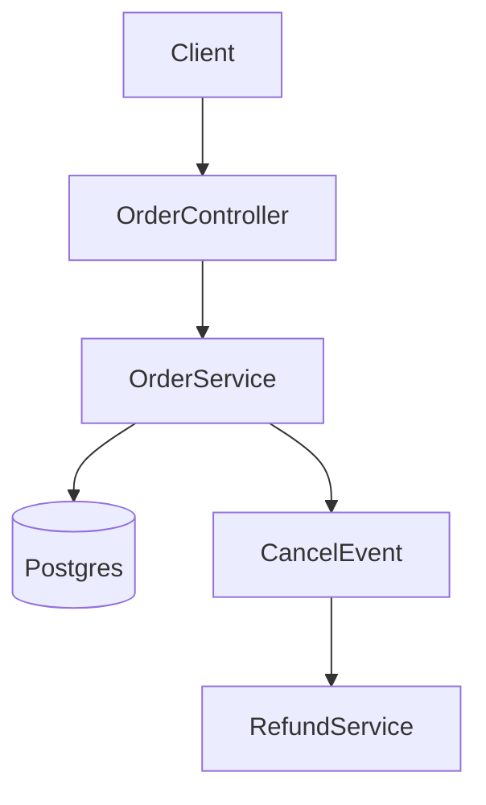

# Cursor Cookbook Recipes: Quick Reference

**Reference**: Chapter 7, Section 7.2 ("Practical Recipes: The Cursor Cookbooks")

What each recipe solves, when to use it, and why it works: Chapter 7, Section 7.2. This file lists what to set up, what to prompt, and how to check the result.

> **Current tool behavior (as of November 7, 2026).** These differ from the printed book:
>
> - Current Cursor has no `@Web` or `@Codebase` symbol. Ask the agent directly. It searches the web and the codebase on its own.
> - Recipe 6 needs Bugbot. Bugbot is not part of Cursor's Free or Plus plans, or the legacy Hobby and Start plans. See [cursor.com/docs/models-and-pricing](https://cursor.com/docs/models-and-pricing) for what your plan includes.

Recipes 1 to 5 need no special Cursor plan.

## Recipe 1: The Agentic Data Scientist

Keep exploratory code in a plain `.py` file with `# %%` cell markers:

```python
# %%
import pandas as pd

raw = pd.read_csv("data/orders.csv")

# %%
clean = (
    raw.dropna(subset=["order_id"])
       .assign(order_date=lambda d: pd.to_datetime(d["order_date"]))
)
clean.describe()

# %%
clean.groupby("region")["amount"].sum().plot(kind="bar")
```

**Setup**

1. Install the Jupyter extension in Cursor (cell execution for both `.py` and `.ipynb`).
2. Keep exploration in `# %%` cells. Move stable code into modules under `src/`.
3. For database work, register a Postgres MCP server. The agent can then run queries as part of a task. See `../code-examples/cursor/mcp-configs/mcp.json`.
4. For large datasets, connect Cursor to a remote machine over Remote-SSH.

**Prompt**

```text
Refactor the data cleaning cells in analysis.py into a DataCleaner class in
src/cleaning.py with one method per transformation step. Keep the notebook
cells as thin calls into the class, and add a pytest test per method using a
10-row fixture.
```

**Done when**:

- The exploratory file still runs cell by cell.
- The transformations live in a tested module.
- A teammate can review the diff as Python, not JSON.

## Recipe 2: The Full-Stack Web Agent

1. **Scaffold** in the Agents Window:

   ```text
   Create a dashboard layout with a sidebar and header using Tailwind CSS.
   ```

   Then use Tab, and Cmd+K on a selection, for the follow-up changes.
2. **Connect Linear.** Add its MCP server to `.cursor/mcp.json`. The agent can then read and update issues.

   ```json
   {
     "mcpServers": {
       "Linear": {
         "command": "npx",
         "args": ["-y", "mcp-remote", "https://mcp.linear.app/mcp"]
       }
     }
   }
   ```

3. **Connect Figma** through an MCP server. The agent can then fetch design details. `../code-examples/cursor/mcp-configs/mcp.json` has a `figma` entry.
4. **Add a design-system rule.** For example, create `.cursor/rules/ui-components.mdc` with `globs: "src/components/*.tsx"`. Tell the agent to reuse existing components instead of inventing new ones.
5. **Verify in the browser.** Use the built-in Cursor Browser (`@Browser` in chat) to navigate, fill forms, and read console logs. You can also paste a screenshot into chat and ask the agent to reconcile it against the code.
6. **Look up library docs.** Ask the agent to search the web.

**Done when**:

- The new screen renders in the browser.
- It reuses the existing components.
- The matching Linear issue is updated.

## Recipe 3: Extending Agency (Build Your Own MCP Server)

1. **Initialize** a small server with Bun or Node.js.
2. **Load context**: give the agent the MCP SDK README URL.
3. **Specify first**: write a `spec.md`. Name each tool (`query_table`, `describe_table`) and its safety constraints ("read-only by default").
4. **Scaffold**: have the agent generate `index.ts` from the spec.
5. **Validate before connecting**: run the server under the MCP Inspector. Check that each tool works on its own.

   ```bash
   npx @modelcontextprotocol/inspector node dist/index.js
   ```

6. **Register it** in `.cursor/mcp.json` and restart Cursor.

For a tested TypeScript server built this way, see Part 4 of [`exercise-3-mcp.md`](../../chapter-08/hands-on-lab/exercises/exercise-3-mcp.md). It targets the Chapter 8 SupportFlow API. Ready-made server configs for Cursor are in `../code-examples/cursor/mcp-configs/`.

## Recipe 4: Visualizing Architecture (Mermaid Diagrams)

Name the scope and the intent in the prompt. Do not ask to "diagram this repo." Use one prompt for control flow and one for data lineage:

```text
Show me how requests go from OrderController to the database using a Mermaid flowchart.

Trace the user_id variable from the input API to the final log entry.
```

For the C4 abstraction loop (component, container, system), see Section 7.2.

**Setup**: install a Mermaid preview extension in Cursor. Fenced `mermaid` blocks then render in the preview pane:



**Where to keep them**: commit the Mermaid source next to the code it describes. Regenerate it in the change that makes it out of date.

## Recipe 5: Scaling Intelligence (Large Codebases)

**Discovery (Ask mode)**:

```text
Explain what the AuthService interface is and what is required to
register a new singleton.
```

Ask directly. The agent searches the codebase on its own.

**Codify the answers as rules**:

- Put the boilerplate a new service needs in a `.cursor/rules` entry: implement `Disposable`, construct with `createDecorator`, then `registerSingleton` it.
- Use glob-scoped rules for invariants such as "use `Array<T>` instead of `T[]`" or "kebab-case filenames."

**Plan before coding**:

1. Switch to Ask mode or Plan mode. Shift+Tab rotates modes.
2. Give the agent the raw context, such as the ticket, internal doc, or error output.
3. Ask for a step-by-step plan that references similar existing files.
4. Check the plan. Switch to Agent mode only when it holds up.

## Recipe 6: Automated Quality Gates (Bugbot Rules)

Put natural-language review rules in `.cursor/BUGBOT.md`. A subproject can add its own, for example `backend/.cursor/BUGBOT.md`. A starting file:

```markdown
# Bug Bot Rules

## Database Migrations
- New indices on existing tables must use CONCURRENTLY to avoid table locks
- Never DROP columns; rename to *_DEPRECATED and map it in the schema
- Prefer TEXT over VARCHAR, and BIGINT over INTEGER

## Query Performance
- New maindb queries must not use JOIN or GROUP BY; handle it in the application layer
- On large tables, avoid OFFSET/LIMIT pagination; use cursor-based pagination

## Security
- No credentials in code
- No eval() or exec()
- Validate all user input
```

**Check it**: open a pull request that adds this migration line. Expect a blocking comment asking for `CONCURRENTLY`:

```sql
CREATE INDEX idx_users_email ON users(email);
```

To run Bugbot on demand, do one of these:

- Comment `bugbot run` on the pull request.
- Run the `/review-bugbot` skill from the agent before you push.

For a fuller version of this file, plus the matching `AGENTS.md` and `.cursor/rules` layout, see Part 5 of [`../hands-on-lab/exercises/exercise-3-governance.md`](../hands-on-lab/exercises/exercise-3-governance.md).
